<p align="center"></p>

# Hearth for WebOS: a fast, calm home screen for webOS TVs

**Hearth for WebOS** is made only for TVs that run webOS.

It works from **webOS 3 up to the newest versions (webOS 25/26)** and it is **designed for speed**: it starts almost instantly, scrolls smoothly and everything is adjustable from the remote.

It replaces the busy home screen with something quiet:

- a **clock with the date and the weather**
- **your apps and TV inputs in one row** along the bottom
- a background that is plain **OLED black**, a **picture**, or a **slideshow** (your own photos or the 25 bundled photos)

It is a normal webOS app (app ID `tld.my.customlauncher`). On a rooted TV it can also become the screen the TV starts into and the one the Home button opens.

**Old and new web views:** one install file runs on **Chromium 38** (webOS 3) and on **Chromium 53 and newer** (webOS 4 up to the newest). A small loader picks the right build when the app starts.

> **Reference device:** an LG TV on firmware **04.60.90 (webOS 7.6.0)**, rooted with the Homebrew Channel. That is where everything is tested. Other TVs are covered by user reports (see *What works on which TV*). Parts that were not tested on a TV are marked **experimental** below.

**New to all this?** The [guides](https://rudra-avatar.github.io/Hearth/) start from a plain TV and explain every word, step by step: [Beginners guide](https://rudra-avatar.github.io/Hearth/BEGINNERS-GUIDE/), [every feature](https://rudra-avatar.github.io/Hearth/customizing/), [Troubleshooting](https://rudra-avatar.github.io/Hearth/troubleshooting/).

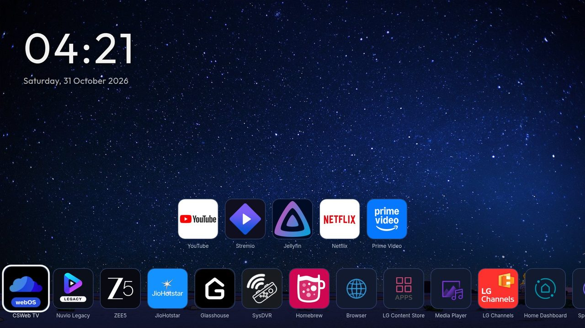

| | |
|---|---|
| 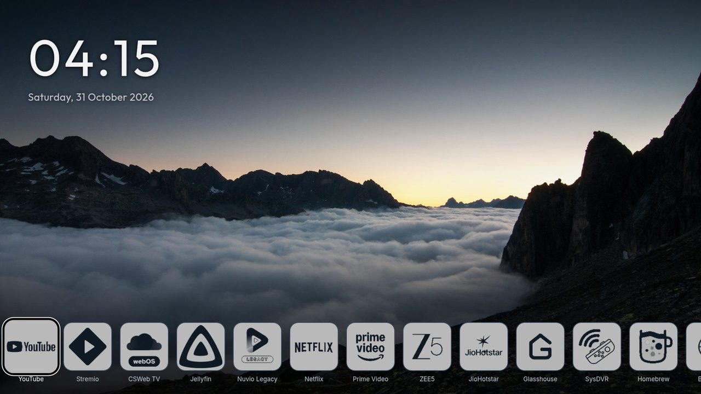 | 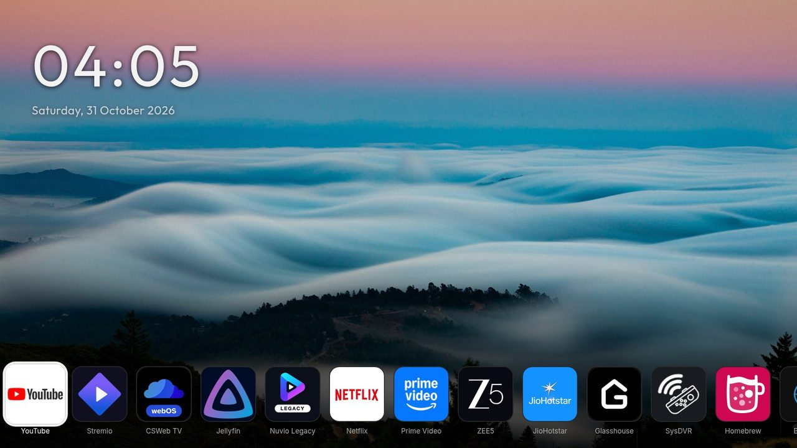 |
| 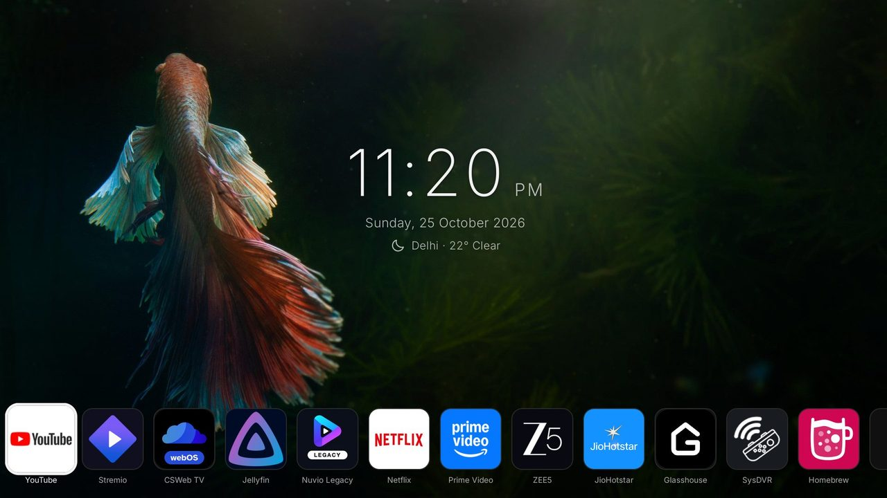 | 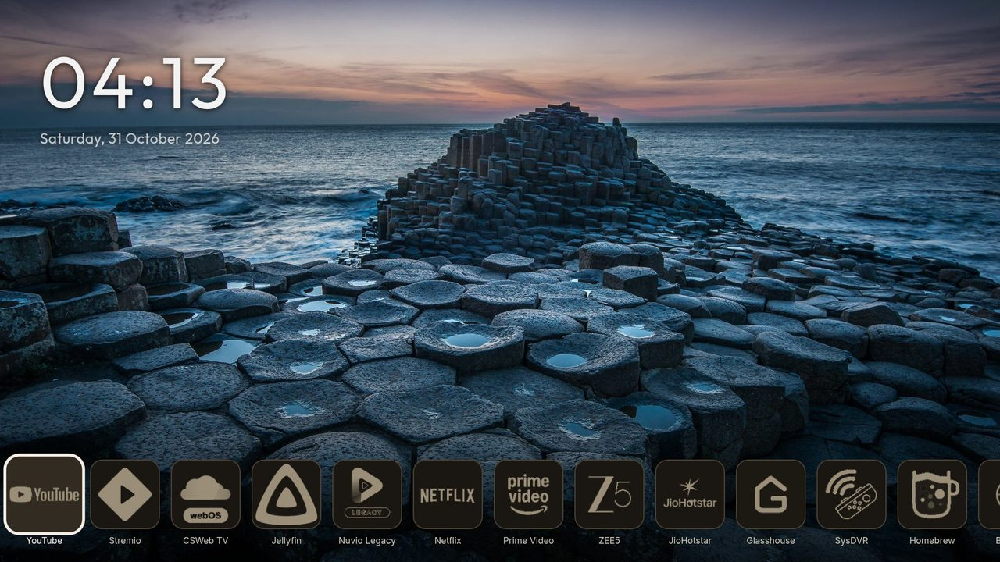 |
| 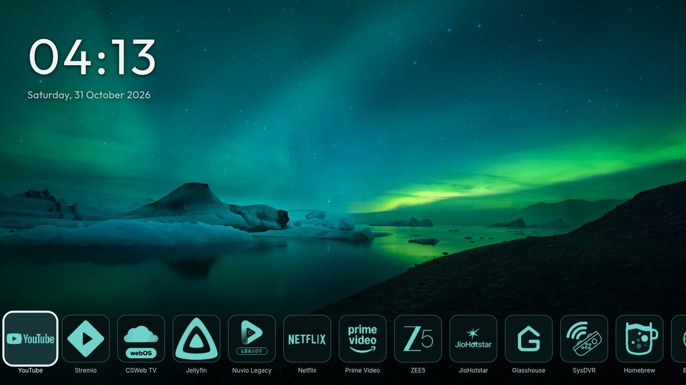 | 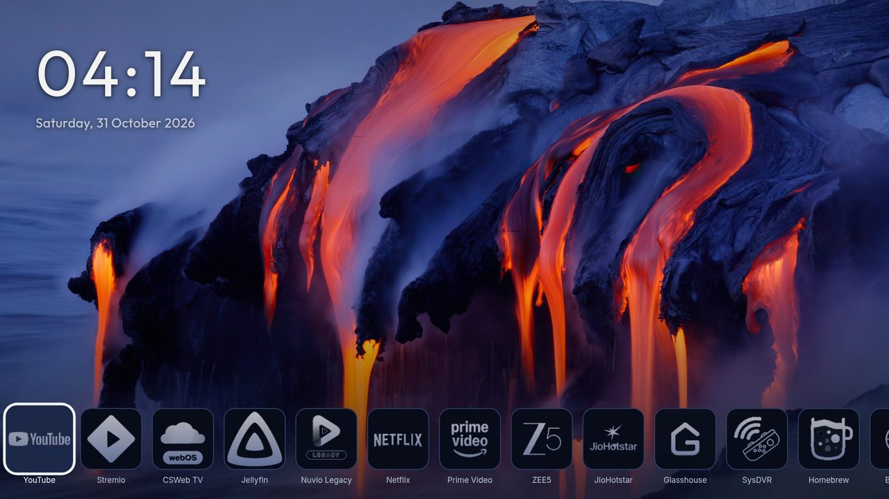 |
| 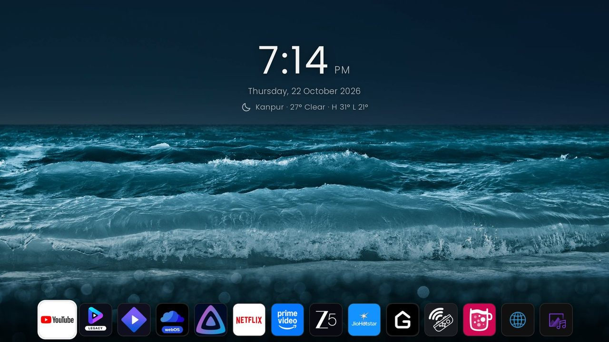 | 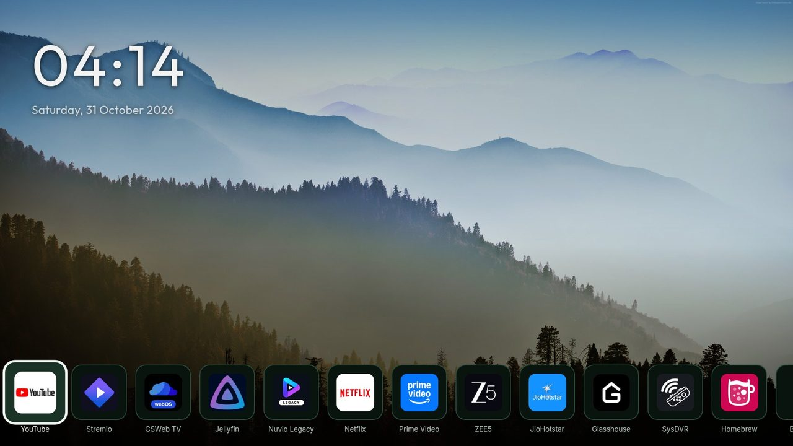 |
| 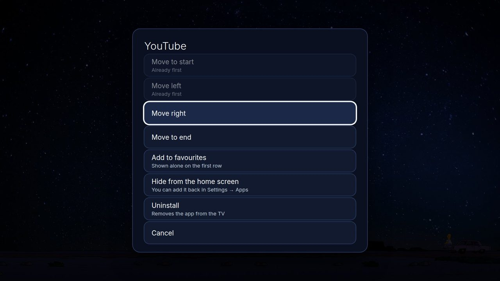 | 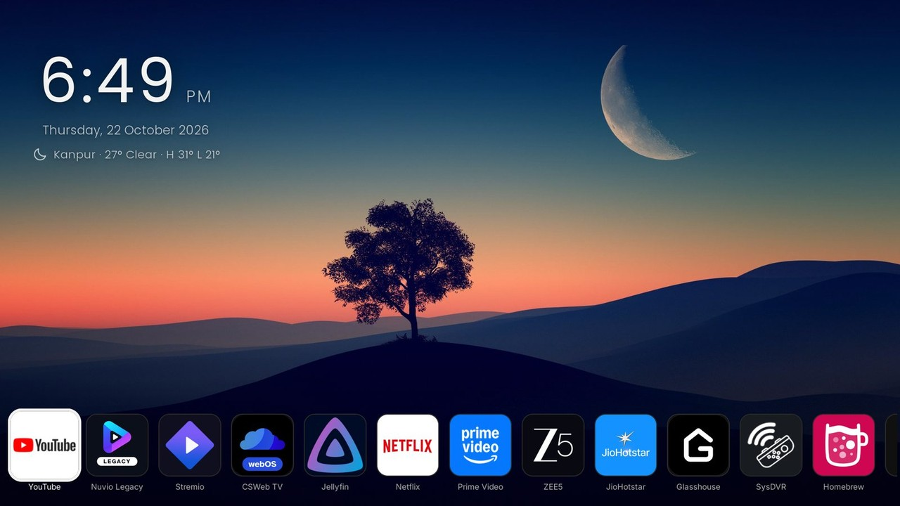 |
| 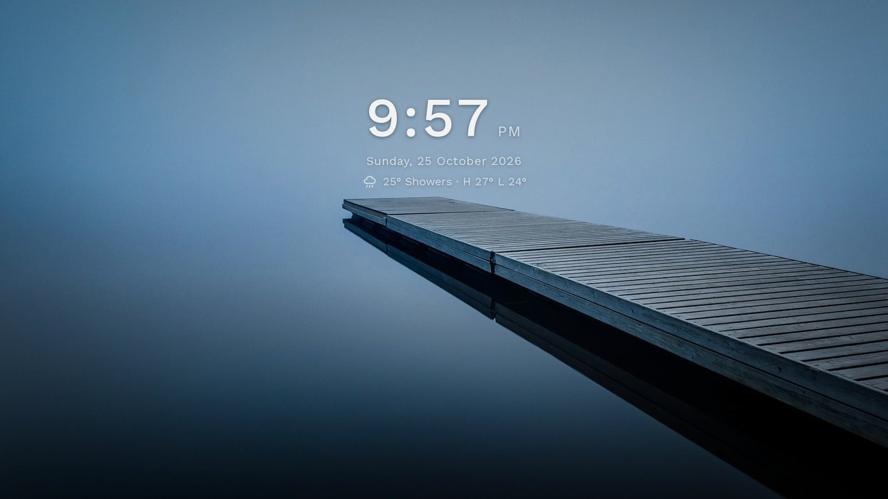 | 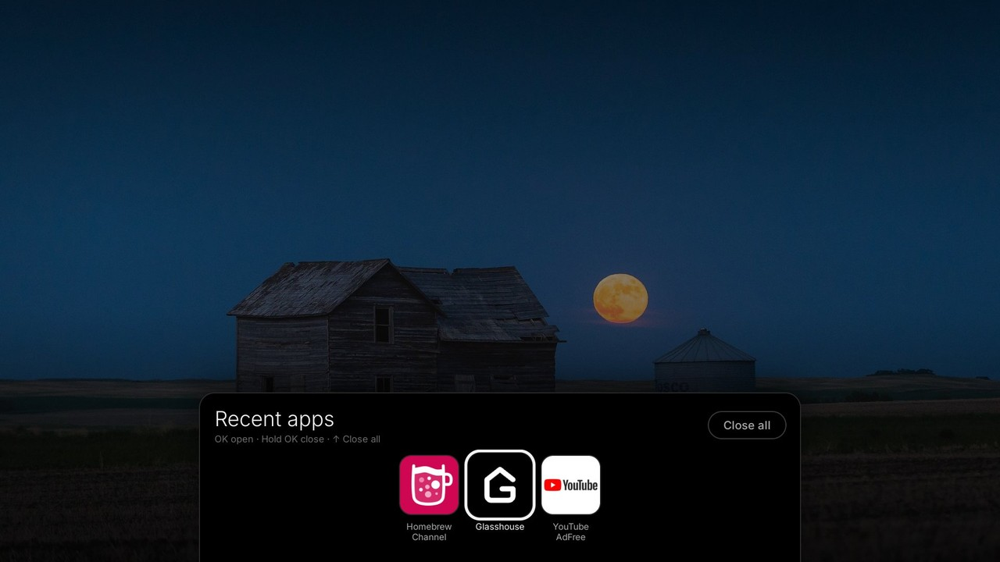 |

## What it does

- **Clock, date and weather.**
  - 27 typefaces; adjustable size, thickness, shadow, colour, opacity, position and alignment
  - 12-hour, 24-hour or "same as the TV"
  - The weather line (temperature, conditions, today's high and low) comes from [Open-Meteo](https://open-meteo.com), needs no account, and can be switched off
  - Pick a city from a list grouped by country (up to 50 each), search for any place over the internet, or add your own cities with a custom theme
  - A live preview sits beside the Widget settings
- **Your apps and inputs in one row.**
  - Choose what is shown, or hold OK on an app for *Reorder home row*, *Add to favourites*, *Hide* and *Uninstall*
  - **Reorder home row** moves apps right on the Home screen: OK picks an app up, the arrow keys move it, OK puts it down
  - **Favourites** make a short row of your most used apps (Down shows all the others)
  - **Most used** puts the apps you open most first
  - Back on the home row opens the **Recent apps** panel (rooted TVs)
  - Inputs with nothing plugged in are greyed out and a connected device's name shows under its input (rooted TVs)
- **Essentials tab.** The settings most people change on one tab (theme, wallpaper, widget, screen saver, quiet mode, icon size). *Edit Essentials* adds, removes and reorders its rows.
- **Help and previews in Settings.** A short help text sits beside the focused row, and rows that change the look show a live preview of the home screen.
- **Your own names and icons.** Hold OK on an app or input in Settings to rename it and pick a different icon, or use your own picture from a USB drive or the TV's storage (rooted TVs).
- **Looks.**
  - Six dark themes: OLED black, Calm blue-grey, Midnight blue, Deep forest, Deep teal, Warm graphite
  - Eight icon styles (including *Glyph*, shapes without a tile) with dark or light tiles, icon colour and opacity (see *Icon styles* below)
  - One or two rows, margins, app-name font and size
- **Custom themes** (rooted). Load a zip with colours, fonts, icons, app order and names, cities and a wallpaper, or export your apps as a starting point. See *Custom themes* below.
- **Wallpaper.** Plain black, one picture, a slideshow of a whole folder (USB drive or the TV's storage, subfolders too) or the bundled photos, with shuffle and an interval from 10 seconds to 1 hour.
- **Network folder** (rooted, experimental). Use pictures, icons, themes, language files and screen saver pictures from a NAS or PC on your home network (SMB share, read only). See *Network folder* below.
- **Quiet mode and OLED care.** After a pause the apps hide and the screen dims; OLED shift moves the picture a few pixels each minute.
- **Screen saver** (rooted, experimental). Your pictures, GIFs, videos or a slideshow, or a built-in fireplace video, in place of the TV's saver; it can switch the TV off after a chosen time.
- **Start the TV straight into Hearth** (rooted). *System, TV start, When the TV turns on, open...* opens Hearth at power-on.
- **The Home button opens Hearth** (rooted). Hearth bundles the Input Hook key hook and starts it itself, so you need no other app; a helper script covers leaving apps with Back.
- **Remote buttons** (rooted, experimental). Give the colour buttons and other dedicated buttons of your remote a new job.
- **Languages.** Hearth's menus can be switched to French, Polish and Brazilian Portuguese (checked by native speakers), to Italian and Thai (by contributors), to Indonesian, Spanish, German, Arabic or Russian (machine translated, waiting for native speakers) or to your own language file. See [Language files](https://rudra-avatar.github.io/Hearth/language_packs/).
- **Updates.** *Settings, System, Check for updates* lists the newer versions with a short summary of each. On a rooted TV you choose a version and Hearth downloads, checks and installs it, with a progress bar (the Homebrew Channel remains the other way). It looks only when you press OK.
- **Made to be fast.** The home screen is drawn from saved data first; everything else (app list, weather, helper checks) happens a few seconds later in the background. While another app is in front, Hearth stops its clock and its timers.
- **Clear messages.** When something cannot work on your TV, Hearth says what and why instead of failing silently, and greys out the options that need a rooted TV.

## What works on which TV

### Tested versions

| | |
|---|---|
| Reference device (everything tested) | Firmware **04.60.90**, **webOS 7.6.0**, rooted, Homebrew Channel 0.7.3 |
| Not rooted | Tested on an LG TV with **webOS 11.2.0, firmware 43.21.44**: the home screen, Settings and the full app list work; options that need root are greyed out with the reason. Other firmware is untested |
| webOS 3.x (Chromium 38) | **Works**, reported by users with two different TVs (details below) |
| Also reported by users | webOS 4.x, 6.x, 8, 9, 10 and 11 (26): see the [Tested TVs table](https://rudra-avatar.github.io/Hearth/COMPATIBILITY/), which lists reports a maintainer has checked |
| Newest versions (webOS 25/26) | **Works.** Reported on webOS 26 (11.2) rooted and not rooted. Hearth uses only standard web features and TV services that LG keeps across versions. Please report anything odd |

**Does it work on your TV?** Tell us with the [compatibility form](https://github.com/rudra-avatar/Hearth/issues/new?template=compatibility.yml). A maintainer checks each report and adds the label `verified`; a workflow then puts it in the table by itself.

### Older TVs: webOS 3.x (Chromium 38)

Hearth works on webOS 3. The maintainer has no webOS 3 TV; the results below come from users.

- One user (webOS 3.x, web view 38): clock, apps and Settings work, and the Home button opens Hearth, also after standby
- Another user (55UH6030-UC, webOS 3.4.3): buttons, weather and wallpaper work, but the *LG Home* tile says "Couldn't open LG Home" (the cause is not known yet)
- Scrolling with the Magic Remote pointer can feel very sensitive

How it works:

- One install file serves every TV. A loader checks whether the web view supports CSS custom properties (Chrome 49 and newer, so everything from webOS 4).
- Newer TVs load `assets/app.js`. webOS 3 TVs load `assets/app.legacy.js` (ES5 with polyfills).
- On webOS 3 the *helper script* opens Hearth when the Home bar is shown.
- webOS 1 and 2 are not supported (no known way to root them).

### Rooted TV (Homebrew Channel): everything

The Homebrew Channel lets Hearth run a few fixed commands on the TV. That powers:

- the live app list with real icons
- Recent apps
- USB and storage browsing for wallpapers
- the Home button and the power-on app
- the screen saver
- remote buttons
- theme and language files
- uninstalling apps

### Not rooted (only Developer Mode): the core, with the extras greyed out

**Works:**

- the home screen, clock and date
- the **weather** (it uses the web view's own internet connection)
- themes, sizes, fonts and colours
- the built-in list of common apps
- the bundled photos and languages
- launching apps

**Needs root, so it is greyed out with the reason:**

- Recent apps
- reading USB and storage for wallpapers and icons
- the Home button and the power-on app
- the screen saver and remote buttons
- theme and language files
- uninstalling apps

Without root, Hearth is an app you open yourself; it cannot replace LG Home or start the TV into itself.

**More apps on the row without root.** The built-in list only shows well-known apps. Two ways to get the rest:

- **Settings, System, the app-list row (tested on webOS 11.2).** Hearth asks the TV for its full app list through LG's remote-control service, with no root and no computer.
  1. Turn on "LG Connect Apps" in the TV's settings (LG menu: Network > LG Connect Apps; newer TVs: All Settings > Connection > Mobile Connection Management).
  2. Choose the row in Hearth.
  3. Press OK on the TV when it asks to allow the connection.

  Newer firmware refuses a web page's own connection, so a small helper service packaged with Hearth makes it. It may not work on every TV or firmware; when it fails, the built-in list stays. The pairing key is kept only inside Hearth. The row is hidden on rooted TVs.

  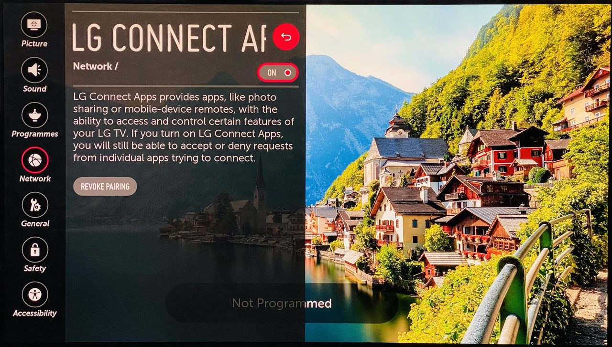
- **By hand.** The [partridgeworks/webos-launcher](https://github.com/partridgeworks/webos-launcher) guide explains how to add custom apps and icons.

### Opening Hearth without root (no Home replacement possible)

Without root nothing can replace LG Home:

- a normal app is suspended or closed when another app opens
- it cannot read which app is in front (the TV refuses it)
- a background service exits after a few seconds

Settings, System has the row *Open Hearth without root: guide* (non-rooted TVs only) with the short version of this section. Two ways to open Hearth:

- **Quick Access (works on any TV, no root).** Open Hearth once, then use LG's own Quick Access: hold one of the number keys 1-9 on the remote (or open the TV's *Quick Access* setting, name varies by webOS version) and choose Hearth. A later press of that number opens Hearth from any app. The TV starts Hearth fresh each time, so it is slower than a rooted setup.
- **A second always-on device (advanced).** [webos-vibehack](https://github.com/OmkarK97/webos-vibehack) (MIT) runs a small watcher on a second device that stays on (a Raspberry Pi or home server). It sees which app is in front and tells the TV to open Hearth when LG Home shows. Needs "LG Connect Apps" on. Not tested with Hearth.

### Experimental, not tested on a TV

These are marked experimental in Settings too:

- the screen saver on webOS 10 and newer
- *Set Hearth as the TV's Home app* (worked on webOS 4.5, not on 7.6)
- *Keep Hearth ready*
- *LG preloaded apps*
- *Map additional keys*

## Install

New to this? The [Beginners guide](https://rudra-avatar.github.io/Hearth/BEGINNERS-GUIDE/) shows every step from a plain TV, including [installing Hearth](https://rudra-avatar.github.io/Hearth/guide/install/).

### Option 1: through the Homebrew Channel (recommended, gets you updates)

1. Open the **Homebrew Channel** on the TV and go to **Settings**.
2. Choose **Add repository** and type this address:

   `https://raw.githubusercontent.com/rudra-avatar/Hearth/main/repo/apps.json`

3. Go back to the app list, open **Hearth** and choose **Install**.
4. **Updating:** when a new version is released, open the Homebrew Channel, open Hearth and it shows the new version (for example "2.0.1 (installed: 2.0.0)") with an **Update** button. On a rooted TV you can also update inside Hearth: *Settings, System, Check for updates*.

**Typing with the TV remote is slow. Easier ways to enter the address:**

- **LG Power** (free Android app; phone and TV on the same Wi-Fi). It is a remote with a keyboard that types straight into the TV. [Google Play](https://play.google.com/store/apps/details?id=com.nic.lgpower), [source](https://github.com/Nicsilver/LGPower) (a hobby project, not made by LG).
- **webOS Dev Manager** skips the typing: install the `.ipk` file from a computer or an Android phone ([Google Play](https://play.google.com/store/apps/details?id=org.webosbrew.devman); Option 2 below).
- **Over SSH** from a computer on the same network:

  `ares-launch org.webosbrew.hbchannel -p '{"launchMode":"addRepository","url":"https://raw.githubusercontent.com/rudra-avatar/Hearth/main/repo/apps.json"}'`

### Option 2: install the file yourself

Download `tld.my.customlauncher_<version>_all.ipk` (for example `tld.my.customlauncher_2.2.0_all.ipk`) from the [Releases](../../releases) page, then use one of these. Computer or phone and TV must be on the same network.

- **webOS Dev Manager on a computer** (Windows, Mac, Linux; [download](https://github.com/webosbrew/dev-manager-desktop)). No root needed, Developer Mode is enough.
- **webOS Dev Manager on an Android phone** (the app *webOS Dev Manager* by webOSbrew on [Google Play](https://play.google.com/store/apps/details?id=org.webosbrew.devman)). The downloaded file is in *Downloads*. We know of no iPhone version.
- **Over SSH** on a rooted TV (commands below).

With Dev Manager, TV with Developer Mode only (not rooted):

1. In the TV's **Developer Mode** app switch **Dev Mode Status** and **Key Server** on and leave the screen open. It shows the TV's IP address and a passphrase.
2. In Dev Manager choose **Add device**, type the TV's **IP address** and the **passphrase**, and confirm.
3. Open the TV's **Apps** page, press **Install** and pick the `.ipk` file.
4. Open **Hearth** from the TV's app list.

With Dev Manager, rooted TV:

1. In the **Homebrew Channel**, *Settings*, switch **Enable SSH server** on (restart if asked). Check that *Root status* is **ok**.
2. In Dev Manager choose **Add device** and type the TV's IP address. A rooted TV is reached over SSH: user `root`, port `22`, password `alpine` unless you set your own or installed an SSH key. If the app lets you choose how to log in, choose the SSH / rooted-TV option. A rooted TV often has no Developer Mode app, so there is no passphrase.

   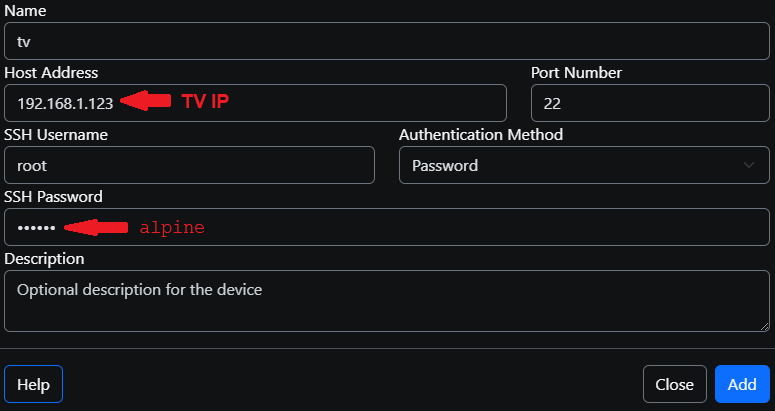
3. Open the TV's **Apps** page, press **Install** and pick the `.ipk` file, then open **Hearth** from the TV's app list.

The step-by-step version with the same steps is in the [install guide](https://rudra-avatar.github.io/Hearth/guide/install/).

With SSH on a rooted TV (replace the file name with the one you downloaded):

```
scp -O tld.my.customlauncher_<version>_all.ipk root@TV_IP:/tmp/
ssh root@TV_IP
luna-send -i luna://com.webos.appInstallService/dev/install '{"id":"com.ares.defaultName","ipkUrl":"/tmp/tld.my.customlauncher_<version>_all.ipk","subscribe":true}'
luna-send -n 1 luna://com.webos.applicationManager/launch '{"id":"tld.my.customlauncher"}'
```

### Updating and removing

Installing over an older version keeps your apps, their order and names, and favourites.

**Updating from 1.x to 2.0.0 resets the look, widget, wallpaper, home-row and quiet-mode values to the new defaults once.** *Settings, Look, Restore my settings from before the update* brings your old values back once.

To remove Hearth, turn off *Replace LG Home with SAM* or *Replace LG Home (helper)*, the screen saver and *Map home button* first, then uninstall "Hearth" from the Homebrew Channel or Dev Manager. If you forget, the next TV start removes their start-up links and folders by itself.

## Using it

| Where | Key | Does |
|---|---|---|
| Home | ← → | Move along the row (the row loops) |
| Home | OK | Open the app. With the *LG Home* and *System Settings* tiles switched on, they open LG's own screens; the last tile is **Hearth Settings** |
| Home | hold OK | The app's menu: reorder the row, favourite it, hide it, uninstall it |
| Home | Back | Open the Recent apps panel (OK opens an app, hold OK closes it, ↑ Close all) |
| Home | ↓ / ↑ | With favourites: show or hide the row of all other apps |
| Settings | ← → on the tab bar | Apps & Sources · Essentials · Look · Widget · Wallpaper · Screen saver · System |
| Settings (Apps, Sources) | OK / hold OK | Show or hide an item / edit its name and icon. **Refresh list**, **Favourites** and **Most used** sit above the grid |
| Settings (other tabs) | OK, or ← → | OK steps through the choices or opens a group; ← → nudge numbers (they stop at the ends) |
| Any other screen | Back | Go back one screen (Back first closes an open group) |

### Settings

- **Apps & Sources:**
  - which apps and HDMI inputs are on the row
  - their order, favourites, names and icons
  - **Refresh list** looks for newly installed apps
- **Essentials:** the rows you chose (a starting set; *Edit Essentials* is the last row).
- **Look:**
  - *Theme*: *Current theme*, *Export theme base*, *Save this theme*, *Delete this theme*
  - *Icons*: size, shape, style, tile, colour, spacing, opacity
  - *Home row*: rows, scroll speed, when Home is pressed, margins, input status, LG Home and System tiles
  - *Labels*: the app names
  - *Quiet mode*: hide after, dim after, dim strength, OLED shift
  - *Favourites* margins and the *Recent apps* panel size
  - **Reset Hearth visual settings to default**
- **Widgets:**
  - *Show the clock widget*
  - *Time and date*
  - *Widget look*: size, font, thickness, position, alignment, colour, shadow, backdrop, opacity
  - *Weather*: on or off, unit, city, city name, today's high and low
  - *PlxNative*: Continue watching and Recently added rows below the home row, account, server, play or open details
- **Wallpaper:** the picture or slideshow, interval, shuffle, opacity and bottom fade.
- **Screen saver (rooted):**
  - the saver on or off and what it plays
  - interval, shuffle, picture size, OLED care, brightness
  - switch the TV off after, show it now
- **System:**
  - *Check for updates*
  - *Hearth language*
  - *Remote control*: Map home button, Map additional keys
  - *TV start*: app list without root, no-root guide, Replace LG Home, When the TV turns on open..., LG logo, Home app
  - *Memory*: LG preloaded apps, Keep Hearth ready, Reopen
  - *Show the Debug tab*: adds the Debug and Tests tabs, for reporting a problem

Every feature is explained in plain words in the [guides](https://rudra-avatar.github.io/Hearth/customizing/).

| | |
|---|---|
| 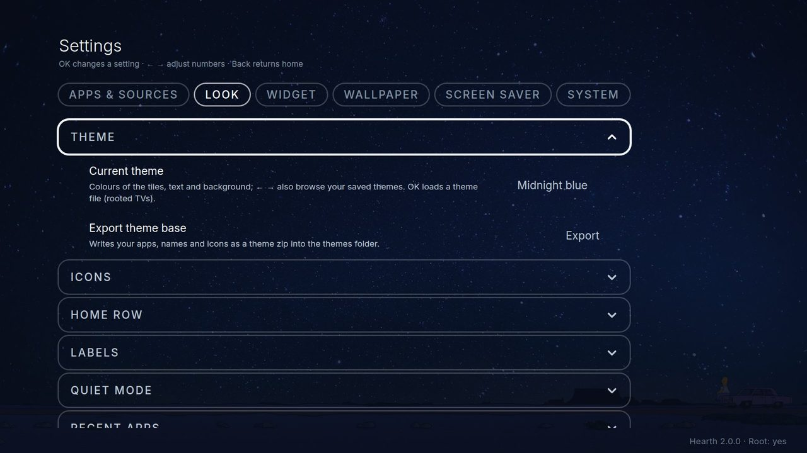 | 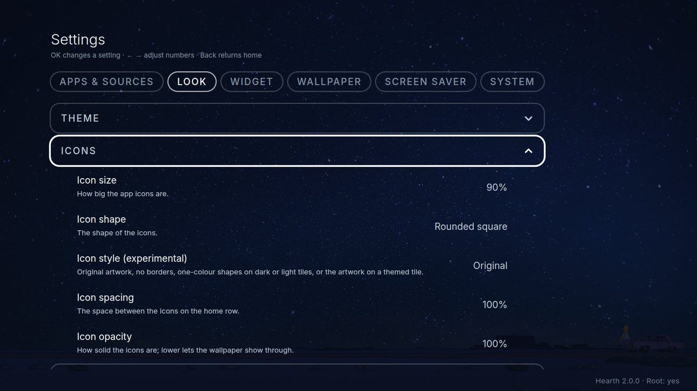 |
| 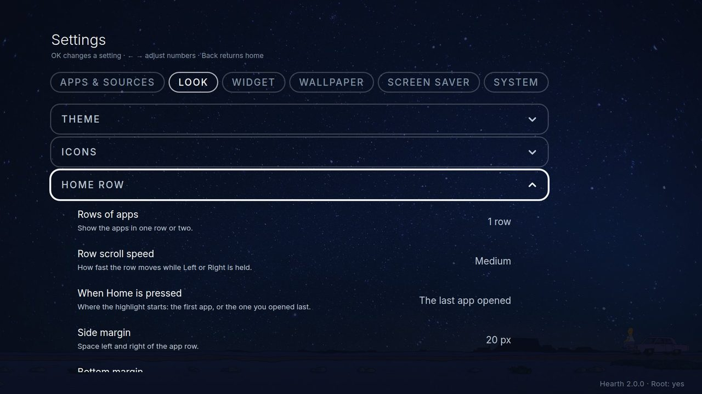 | 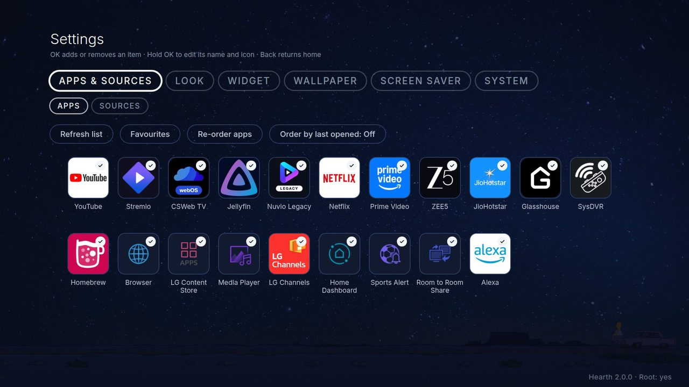 |
| 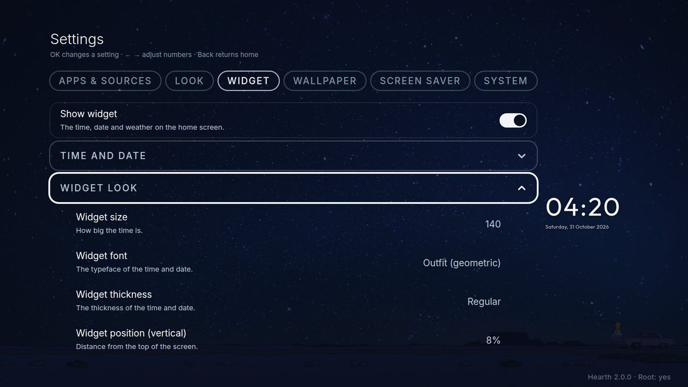 | 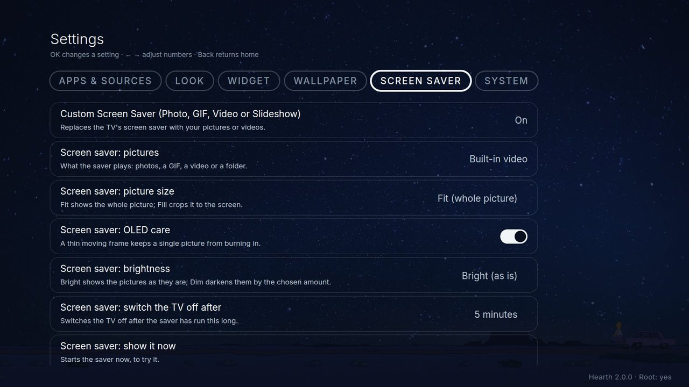 |
| 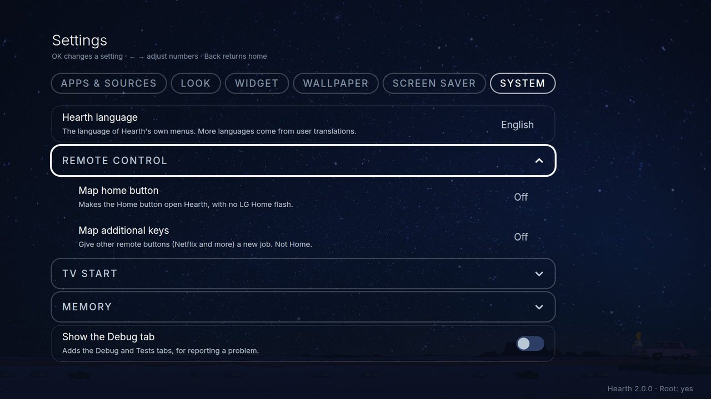 | 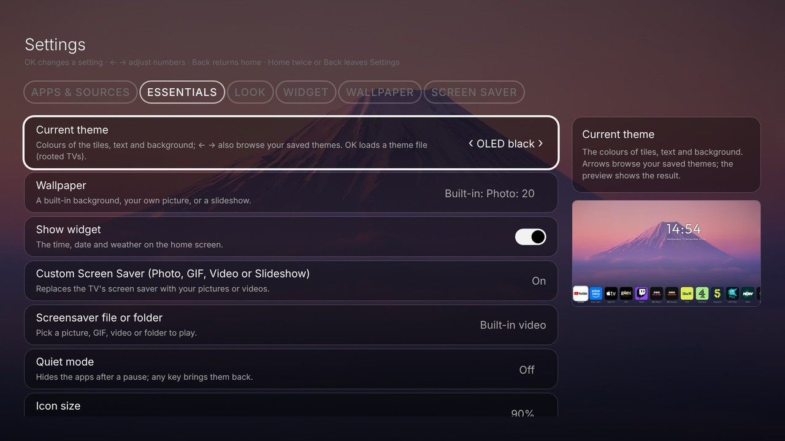 |

### Essentials, help and previews

The **Essentials** tab collects the rows most people use. Its last row, **Edit Essentials**, opens a list: OK adds or removes a row, and ← → moves a chosen row up or down. **Reset to default** brings the starting set back. The rows also stay in their own tabs.

While you move through Settings, a short **help text** beside the list says what the focused row does. Rows that change how Home looks (icon size, shape, margins, row speed, wallpaper, widget position) also show a small **preview** of the home screen, so you see the result before you leave Settings.

| | |
|---|---|
| 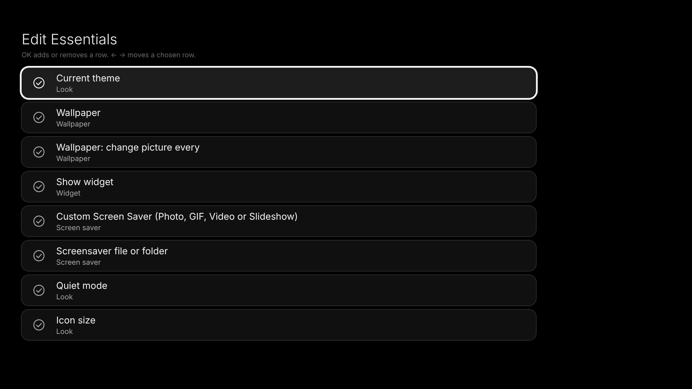 | 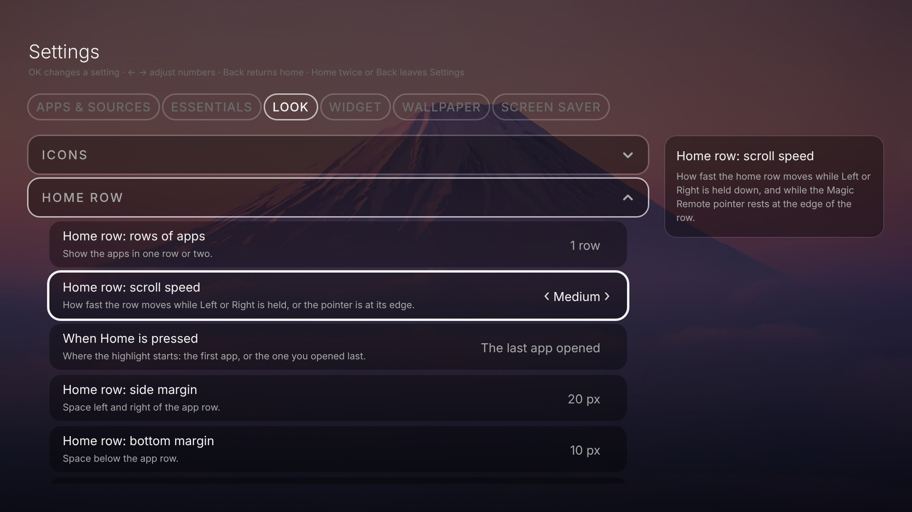 |
| 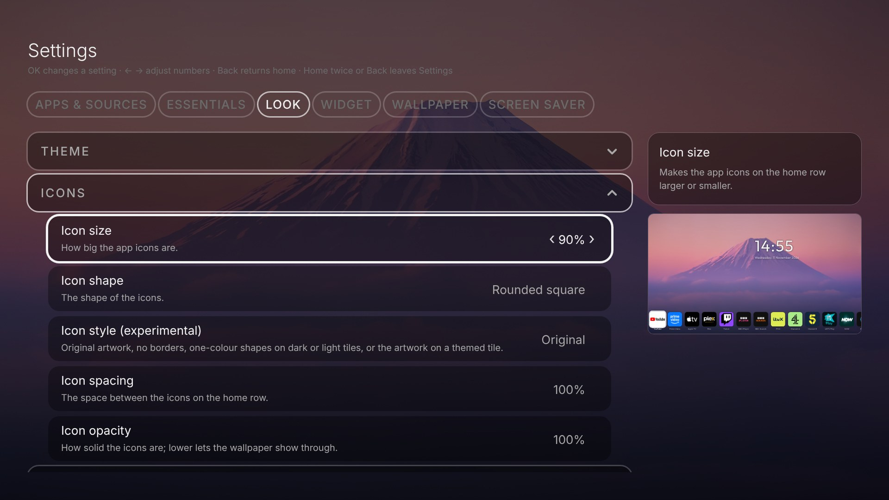 | 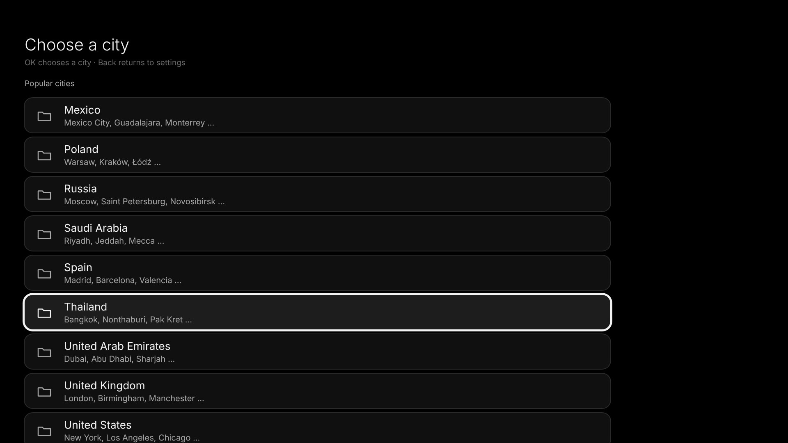 |

### Icon styles

*Settings, Look, Icons, Icon style* (experimental) changes how every icon on the row is drawn. The change shows at once.

- **Original:** the real picture of each app.
- **Minimal:** the real picture without a border.
- **Dark mono:** a light grey one-colour shape on a dark tile.
- **Soft mono:** a muted one-colour shape on a slightly lighter tile.
- **Accent mono:** the one-colour shape in the theme's accent colour (not offered with OLED black).
- **Gradient mono:** the one-colour shape fades from light to darker.
- **Tinted tile:** the real picture on a tile in the theme's colour.
- **Glyph:** just the one-colour shape, with no tile. The highlighted icon only grows. *Icon tile: Dark* gives dark shapes and labels, *Light* gives light ones.

Beside it, **Icon tile** picks a *Dark* tile with a light shape or a *Light* tile with a dark shape, **Icon colour** changes the shape colour, and **Icon opacity** lets the wallpaper show through. Size, spacing and shape have their own rows.

### Edit a name or icon

In **Settings → Apps & Sources**, move to an item and **hold OK** (release OK, then press ↓ to edit). The home row shows each change at once, and it is kept across restarts and updates.

| | |
|---|---|
|  |  |

- **Name:** up to 24 characters. For an input, ← → step through suggestions (PlayStation 5, Xbox, Laptop and more); OK types any name with the on-screen keyboard. For an app, OK types a name.
- **Icon:** ← → or OK step through the icons that come with Hearth: inputs have 16 symbols, apps have the bundled logos of common apps.
- **Use a picture from a USB drive or the TV:** pick your own image (a square one works best; it is cropped to a square and shrunk). Needs a rooted TV. The picture is saved inside Hearth's settings, so the USB drive can be removed afterwards.
- **Use the app's (or the TV's) name and icon:** puts the original back.
- The names in the *Hide* and *Uninstall* menus stay the app's real names.

### Wallpaper


**Settings → Wallpaper → Wallpaper** opens a folder browser. It shows:

- the bundled photos
- a **USB drive**
- **Internal storage** (`/media/developer`)

OK on a picture sets it. **Play this folder as a slideshow** plays every picture in the folder (a second row also plays its subfolders). Use JPG, PNG, WebP or BMP.

A web app cannot read files itself, so on a rooted TV the Homebrew Channel's service reads them in small pieces. If it cannot, the screen says why and offers **Try again**.

**Before you choose:** big pictures slow the launcher down, so the smaller the file, the faster Hearth starts. **The recommended size is 1920x1080**, a good balance of quality and performance; please resize your wallpapers to it.

The hard limit is **8 MB and 25 megapixels** per picture. A picture over the limit is skipped in a slideshow and refused as a single wallpaper.

**Copying your own pictures to the TV** (rooted TV; `<TV address>` is the **IP:** number at the bottom right of Hearth's Settings):

1. Put wallpaper pictures in **`/media/developer/wallpapers`**. Hearth makes this folder for you (see *Folders Hearth makes* below). Screen saver pictures, GIFs and videos go in **`/media/developer/screensavers`**. The pickers show both first (*Wallpapers folder*, *Screen savers folder*).
2. **From a computer with SSH:** `scp photo.jpg root@<TV address>:/media/developer/wallpapers/` (if `scp` fails, try `scp -O photo.jpg ...`).
3. **Without an SSH client:** connect to the TV in [webOS Dev Manager](https://github.com/webosbrew/dev-manager-desktop) and use its file or terminal option to copy into the same folder. A USB drive works too.
4. Open **Settings → Wallpaper → Wallpaper** and choose the picture or the folder.

### Network folder (rooted, experimental)

A shared folder on a NAS, a router with a disk, or a PC can be a place in every file picker (wallpaper, icon, theme, language and screen saver). Hearth only **reads** from it (SMB sharing, with a guest login or a user name and password).

Set it up once: **Settings, Wallpaper, Wallpaper**, go to the last row, **Network folder (not set up)**, type the NAS address and the shared folder name, then **Connect**. The same rows then appear in the other pickers.

The TV forgets the connection at every restart; Hearth connects again when it needs the folder and does not slow down the start. **If the NAS cannot be reached, everything falls back to its default:** the wallpaper to the default background (your choice stays saved), the screen saver to the built-in video, and icon, theme and language keep what was set before. A restart tries the NAS again (the screen saver looks every 20 seconds for 2 minutes).

Steps, the list of error messages and what each one means: [Network folder guide](https://rudra-avatar.github.io/Hearth/features/network-folder/).

### Folders Hearth makes on the TV

On a rooted TV Hearth makes folders under `/media/developer`, each one only when something needs it.

**Folders for your own files.** Each is made once, when you open the matching picker. A folder you delete is not made again.

| Folder | What goes in it | Made when |
|---|---|---|
| `wallpapers` | your wallpaper pictures | you open a wallpaper or screen saver picker |
| `screensavers` | your screen saver pictures, GIFs and videos | the same |
| `themes` | theme zips and `theme_base.zip` | you open the theme picker or use *Export theme base* (which replaces an older `theme_base.zip`) |
| `languages` | language files | you open the language file picker |

**Folders for a feature.** Each is made when you switch the feature on. They hold Hearth's own scripts and settings, so leave them alone.

| Folder | Feature |
|---|---|
| `launcher-homehook` | *Replace LG Home (helper)* |
| `launcher-homekey` | *Map home button* (the bundled Input Hook key hook) |
| `launcher-screensaver` | the screen saver |
| `launcher-poweron` | *When the TV turns on, open...* |
| `launcher-homeapp` | *Set Hearth as the TV's Home app* |
| `launcher-keepready` | *Keep Hearth ready* |
| `launcher-preload` | *LG preloaded apps* |
| `launcher-remap` | *Map additional keys* |
| `launcher-theme` | a loaded or saved custom theme |

If you uninstall Hearth while the helper, the screen saver or *Map home button* is still on, the next TV start removes their start-up links and folders by itself.

### Weather and privacy

The weather comes from [Open-Meteo](https://open-meteo.com) (free, no account).

**More cities.** Three ways to choose where the weather is for:

- pick a city from the list (grouped by country, up to 50 each)
- choose **Search for a city** and type any place name (worldwide; needs the internet)
- add your own cities with a custom theme (the `cities` part, see *Custom themes*); they appear at the top of the City list

**What is sent:** only the latitude and longitude of the city you chose, and the words you type in the city search.

**When:** the weather is fetched a few seconds after Hearth appears, then every 30 minutes while Hearth is in front. The last reading is kept so the home screen never waits for the internet. A reading older than 6 hours is not shown.

**Older TVs:** if the TV's web view cannot make a secure connection (some older TVs cannot), Hearth asks the TV's own `curl` or `wget` through the Homebrew Channel instead. The last-resort attempts skip the certificate check, which is acceptable for public weather numbers that are only ever read as numbers and a place name.

### Screen saver (rooted, experimental)

*Settings, Screen saver, Custom Screen Saver (Photo, GIF, Video or Slideshow).* It is **on by default with a built-in video**; a failed set-up turns it off with a message.

Under *Pictures* you can choose:

- a photo
- a GIF
- a video (mp4, mkv, webm; muted, plays to its end)
- a folder
- the bundled photos
- "Same as the wallpaper", which follows the Wallpaper row

How it behaves:

- The TV decides when it starts: it uses the idle time in the TV's own screen saver settings, so make sure the TV's saver is on.
- Any key ends it.
- *Switch the TV off after* puts the TV in standby after the saver has run that long.
- A very large GIF or video may use a lot of memory, and GIFs, videos and fast slideshows use more power than a still picture.
- Some TVs hold the saver back (OLED, no-signal inputs).

Nothing is changed on the TV's storage: a file is mounted in memory over LG's screen saver file, and a start-up link mounts it again after a restart. Switch it off in the same row; a restart puts LG's saver back.

**On webOS 10 and later** LG's saver is a different kind of app. Hearth mounts a changed copy and asks the TV to read it again. This is untested on a TV; if the TV does not take it, LG's saver stays.

**Credit:** the method for webOS 10 and later is the one documented by [Glasshouse](https://github.com/rorygallagher2024/glasshouse) by Rory Gallagher (MIT); see Credits.

If the saver does not work, send the output of `sh /media/developer/launcher-screensaver/screensaver.sh diagnose` (over SSH).

### Custom themes (rooted)

A custom theme is **one zip file**. Hearth can load it, keep it and take it away again. You do not start from nothing: Hearth writes a starting zip for you.

**What a theme can change.** Every part is optional; a theme can hold just one of them.

- colours: the theme palette, the widget colour (or your own colour) and the icon colour
- fonts: your own font files for the widget and for the app names
- icon style and tile (dark or light)
- the wallpaper: one picture, or a folder of pictures as a slideshow
- app icons: one picture per app
- app order and app names
- cities for the weather (added at the top of the City list)

**Step by step**

1. **Export the base theme first.** Do not start from an empty zip: the export is how your app list and icons get into a theme. *Settings, Look, Theme, Export theme base.* Hearth writes `theme_base.zip` into `/media/developer/themes`. It holds your apps in their present order, their names, their icons and a copy of the theme guide.
2. **Copy it to a computer.** Over SSH: `scp root@<TV address>:/media/developer/themes/theme_base.zip .` (or use the file option of webOS Dev Manager, or a USB drive).
3. **Unzip it and customise it.**
   - Edit `manifest.json` to add or change parts: colours, fonts, wallpaper, cities, the order and names of apps.
   - Replace pictures in the icon folder with your own.
   - Keep icons small (64 to 256 pixels, a few KB each) and wallpapers at 1920x1080; heavy files slow Hearth down.
   - Allowed files: pictures (png, jpg), fonts (woff2, woff, ttf, otf), the manifest and notes. Scripts and programs make Hearth refuse the theme.
   - Every part is explained in the [theme guide](https://rudra-avatar.github.io/Hearth/theme/theme-guide/). You can also give the guide and the zip to an AI helper.
4. **Zip it again** so that `manifest.json` is at the top of the zip, not inside a folder. A ready-made empty example is `docs/theme/theme_name.zip` in this repository.
5. **Copy the zip back** to `/media/developer/themes` on the TV (or put it on a USB drive).
6. **Load it.** *Settings, Look, Theme, Current theme*: press OK and pick the zip. A wrong file changes nothing; Hearth shows a pop-up with the reason.
7. **Keep or remove it.** *Save this theme* keeps it inside Hearth, so ← → under *Current theme* can pick it again. *Delete this theme* removes it, and what it set goes back to the defaults.

A theme puts its values into the normal settings, so you can still change them afterwards. A theme wallpaper replaces your wallpaper while the theme is loaded, and an icon you picked yourself for an app wins over the theme's icon.

### Languages

*Settings, System, Hearth language*: the arrows switch between:

- English
- the languages that come with Hearth (no root; they arrive with updates)
- your own language file (OK loads it, rooted TVs)

The bundled French pack (by Foxinou35), Italian pack (by doppiaRR), Polish pack (by sir_RAFIK), Brazilian Portuguese pack (by assanches) and Thai pack (by MangaThatsFine) were written by native speakers. The bundled Indonesian, Spanish, German, Arabic and Russian packs are machine translated and are shown as *(machine translated)* until a native speaker reviews them.

To add a language, see [Language files](https://rudra-avatar.github.io/Hearth/language_packs/) and the *Translation* issue form. Supported scripts: Latin, Cyrillic, Greek and Arabic (left to right).

## Replacing LG Home (rooted TVs)

### Recommended settings

For a clean, minimal and easy way to use Hearth as your main launcher, switch on these five settings together:

1. **Replace LG Home with SAM** (experimental): Hearth takes LG Home's place in the TV itself, so LG Home never flashes. Tested on webOS 7; if it does not work on your TV, use **Replace LG Home (helper)** instead.
2. **Map home button:** the Home button opens Hearth at once, with no flash of LG Home.
3. **When the TV turns on, open...:** choose Hearth, so the TV starts in Hearth.
4. **Keep Hearth ready** (experimental): Hearth stays in memory, so it appears immediately.
5. **Turn off preloaded app:** (Optional) LG keeps a lot of apps half-awake in the background which can severely cripple older, slower TVs. Turn them off to get a smoother experience.


Together they make Hearth the screen you see when the TV starts, when you press Home and when you leave an app, so you never need to see LG Home again. The *LG Home* tile in Hearth still opens it if you ever want it.

SAM puts Hearth where LG Home would be, so LG Home does not show at all. The helper can only react once LG Home is already in front, so with the helper LG Home may still flash for a moment after leaving an app with Back (the Home button itself does not flash).

**Set it up (once):**

1. Install Hearth from the Homebrew Channel (see Install).
2. Open **Settings, System, TV start** and switch on **Replace LG Home with SAM (experimental)**. Read its warning first. On a TV where it does not work, switch it off and use **Replace LG Home (helper)** instead.
3. Open **Settings, System, Remote control, Map home button** and press Home when asked.
4. In **Settings, System, TV start**, open **When the TV turns on, open...**, choose Hearth, then restart the TV once.
5. Open **Settings, System, Memory** and switch on **Keep Hearth ready**. Read its warning first.
6. Optional: turn off the LG logo at start-up (**Show the LG logo when the TV starts**, in *TV start*).

The next sections explain each setting.

### Map home button (flash-free Home key, no other app needed)

*Settings, System, Remote control, Map home button.* Hearth bundles the [Input Hook](https://github.com/Simon34545/lginputhook) key hook (credited below) and starts it itself, so you do not need the Input Hook app.

Press the Home button when asked:

- If its code is one LG is known to use (773, 774 or 125), Hearth maps it by itself and a pop-up says whether it worked.
- If not, a guide shows the pressed button on a drawing of your remote, and you can pick a code by hand.
- The mapping is kept across restarts.

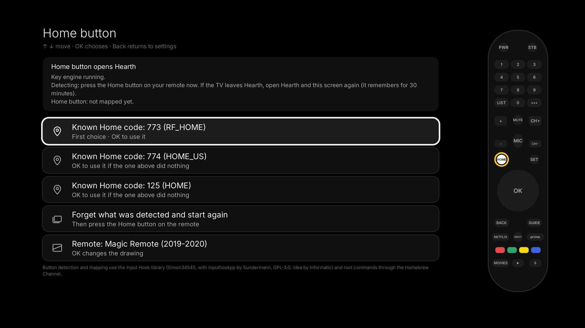

If the separate *Input Hook* app is installed with its own bindings, Hearth greys the rows out and says why. Hearth never changes that app's settings.

### Replace LG Home with SAM (experimental) (Settings, System, TV start)

The TV has a part called SAM that keeps the list of apps and decides what opens when you press Home. This setting puts a plain black page in LG Home's place and asks SAM to read it, so the TV opens Hearth wherever it would open LG Home, with **no flash of LG Home**.

- It starts about 25 seconds after the TV starts. SAM may be restarted once while it is switched on, and the screen can blink for a few seconds.
- It was tested on webOS 7 only.
- It cannot be on at the same time as *Replace LG Home (helper)*: each one is greyed out while the other is on.
- Switch it off to give LG Home its place back. On a TV that had to restart SAM, restart the TV once more afterwards.
- The method comes from [Glasshouse](https://github.com/rorygallagher2024/glasshouse) by Rory Gallagher (credited below).

### Replace LG Home (helper) (Settings, System, TV start)

A small background helper watches which app the TV reports as being in front. When that becomes LG Home (Home button, leaving an app with Back, boot) it opens Hearth instead. **Nothing is replaced or mounted.** One click installs the helper, starts the bundled key hook and maps the Home button (code 773).

- It starts at boot (a link in the TV's startup folder) and also whenever Hearth is on screen.
- **LG Home can flash for a moment** before Hearth opens, because the helper can only react once LG Home is already in front. *Map home button* avoids the flash for the Home key.
- The "LG Home" tile still opens LG's own Home.
- **Turn it off before uninstalling Hearth.** Reversal steps and a diagnostics script: [`src/homehook/README.md`](src/homehook/README.md).

### Start the TV on Hearth

*System, TV start, When the TV turns on, open...* makes the TV open Hearth when you switch it on (remote, the TV's own button, a cold start; optionally also a network wake-up).

- It needs one full restart of the TV to start working.
- It is undone by choosing *TV default* (or `rm /var/luna/preferences/bootd.json` over SSH).
- *System, TV start, Add Hearth as a TV input* (On/Off, rooted TVs) lists Hearth next to HDMI 1. Set the TV to start on its last input.

Details and undo steps: [`src/poweron/README.md`](src/poweron/README.md).

### Keep Hearth ready (experimental)

*System, Memory, Keep Hearth ready* asks the TV to keep Hearth in memory so the Home key shows it at once.

- It uses TV memory, so Hearth shows a warning first.
- A failing step switches it off with the reason.
- *Reopen Hearth if the TV closed it* works only together with it.
- Both rows are greyed out on a TV that has no memory list.

### Set Hearth as the TV's Home app (experimental, webOS 4.x)

*System, TV start, Set Hearth as the TV's Home app* writes Hearth into the TV's own Home app setting so the Home button opens it directly. The old value is kept and put back when you switch it off.

- It worked on webOS 4.5 (LG 65UM7100PLA, tested by Obednal97).
- On webOS 7.6 the setting is stored but the Home button ignores it.
- It cannot be used together with *Replace LG Home (helper)*, so it is not part of the recommended settings.

Undo steps: [`src/homeapp/README.md`](src/homeapp/README.md).

### Other rooted features

- **Map additional keys (experimental).** *System, Remote control, Map additional keys* gives the colour buttons and other dedicated buttons of your remote a new job: open an app, switch to an input, act as another remote button, or run a TV action (the ones not yet tried on a real TV are marked *untested*).
  - *Add a button* lets the remote say which button is meant: press it when asked.
  - Home, arrows, OK, Back, power, volume, channels and numbers are never taken.
  - It uses the same small key helper as *Map home button* (the open-source *Input Hook*, bundled with Hearth). No key filter is added to the TV any more, and the mapped buttons stay after restarts.
  - Buttons mapped with an older version (*Reassign remote buttons*) are not carried over: Hearth removes the old filter once, backs the old map up and tells you to map the buttons again.

  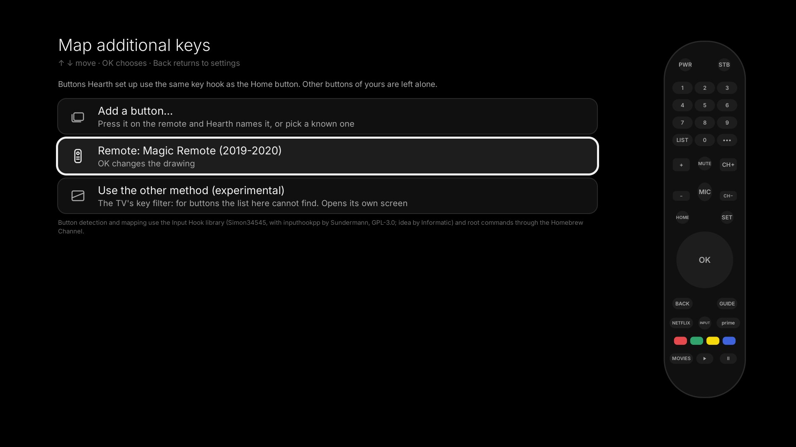
- **LG preloaded apps (experimental).** LG keeps some apps (YouTube, the browser and other video apps) loaded in the background so they open fast; on some TVs that holds several hundred MB.
  - *System, Memory, LG preloaded apps* lists the ones LG preloads on your TV, with the memory each takes once loaded.
  - OK switches one off (it then opens a little slower, and its memory is free) or back to LG's own setting.
  - Nothing is closed. *Everything back to LG's setting* undoes it.

## webOS 11: one extra step on rooted TVs

On webOS 11 (found on an LG C4, firmware 43.21.73, by ganondorft; the fix is reported working by several users) the TV only lets an app use the Homebrew Channel's command service when the app's Luna permissions include `org.webosbrew.hbchannel.service.group`.

The app installer leaves that out for Hearth, so even on a rooted TV every option that needs root is greyed out with *"the TV refused the command"*, the app icons are letters, and the wallpaper picker cannot read the storage.

Older webOS versions do not need this.

The script `tools/webos11-permission.sh` (inside the app) adds the permission. The installer writes Hearth's permission file again on every install or update, so the script installs itself as a boot hook that checks it at each start. Once, over SSH on the TV:

```
sh /media/developer/apps/usr/palm/applications/tld.my.customlauncher/tools/webos11-permission.sh
```

Or from a computer, with the file from this repository (`public/tools/`):

```
scp -O webos11-permission.sh root@TV_IP:/var/lib/webosbrew/init.d/40-hearth-permission
ssh root@TV_IP 'chmod 755 /var/lib/webosbrew/init.d/40-hearth-permission; sh /var/lib/webosbrew/init.d/40-hearth-permission'
```

Then close and reopen Hearth. After updating Hearth, restart the TV (or run the command again). To undo it, delete `/var/lib/webosbrew/init.d/40-hearth-permission` and reinstall Hearth.

## Troubleshooting

More in the [Troubleshooting guide](https://rudra-avatar.github.io/Hearth/troubleshooting/). To report a problem, switch **System, Show the Debug tab** on and send `/tmp/hearth-debug.txt` with a [GitHub issue](https://github.com/rudra-avatar/Hearth/issues).

- **"Can't read the storage" / a greyed-out row:** the message tells you which of these it is. *The Homebrew Channel service is not running*: the TV is not rooted, or it is rooted but the service has not started (open the Homebrew Channel once, then try again). *Did not answer in time*: the service is still starting, try again in a moment. *The TV refused it*: this TV does not allow it without root.
- **A picture will not show:** the message says why (over 8 MB, over 25 megapixels, or not a picture).
- **USB drive missing in the picker:** plug it in, then open the picker again. The TV must have mounted it.
- **The weather does not appear:** check the TV's internet connection; it tries again by itself after 2, 10 and then 30 minutes.
- **The Home button shows LG Home for a moment:** the helper script can only react once LG Home is in front. Use *Map home button*.
- **The Home button does not open Hearth:** the key code differs between remotes; run the guide in *Map home button*. If the Input Hook app has its own bindings, Hearth's rows are greyed out with a reason.
- **Hold OK does nothing** on an app: users report that **turning the TV off and on again** (unplug it for a minute) fixes it. The cause is not known yet.
- **Root options greyed out with "the TV refused the command", or elevation (root) problems:** update the Homebrew Channel to **0.8.0-rc1** ([release page](https://github.com/throwaway96/webos-homebrew-channel/releases/tag/v0.8.0-rc1)) and open it once. On webOS 11 also do the permission step above.
- **The remote stops answering after you map buttons:** restart the TV (unplug it for 30 seconds). If that does not help, connect to the TV over SSH as `root` and remove Hearth's start-up links, then restart the TV again:
  ```
  sh /media/developer/launcher-remap/apply.sh off
  rm -f /var/lib/webosbrew/init.d/47-launcher-remap /var/lib/webosbrew/init.d/48-launcher-homehook /var/lib/webosbrew/init.d/49-launcher-homekey
  ```
  - If the first line says it cannot find the file, you never used the old *Reassign remote buttons*: go on with the second line.
  - **Only if you also use the Input Hook app** and the remote still does not work, type these two lines as well (they delete its start-up link and its saved button settings, which also removes Hearth's Home button mapping), then restart the TV:
    ```
    rm -f /var/lib/webosbrew/init.d/inputhook
    rm -f /home/root/.config/lginputhook/keybinds.json
    ```
  - The old *Reassigned buttons* switch no longer exists. If the problem comes back when Hearth opens, go to **Settings, System, Remote control** and remove the buttons you mapped in *Map additional keys* and *Map home button*. Step-by-step: [Troubleshooting guide](https://rudra-avatar.github.io/Hearth/troubleshooting/#the-remote-stops-answering).
- **The Home button does nothing after uninstalling Hearth:** right after uninstalling it can stay dead until the TV restarts. Restart the TV (unplug it for 30 seconds); the clean-up then finishes and the Home button works again (confirmed by a user).
- **Odd layout after changing sizes:** Settings, Look, **Reset Hearth visual settings to default**.

## Credits

**Code contributions** (applied by hand into Hearth's own code; authors credited in the commits and the changelog):

- **Alejandro Morales**, pull request #1: slideshow shuffle that survives restarts.
- **chriskoperdraad-tech**, pull requests #2, #3, #37 and #54: webOS 3.x (Chromium 38) support (the Home-bar watcher lines are theirs; the ES5 build and the custom-property fallback are Hearth's own code) and the fix that lets *Map home button* find the Home button's code on webOS 3 (#37). The finding that helpers started through the Homebrew Channel keep its open sockets, and the idea of closing them before a helper starts (#54, written again in Hearth's own code). Also the testing and research on a webOS 3.9 TV that shaped Hearth's webOS 3 support (issue #23).
- **ganondorft**, pull request #6: the webOS 11 permission fix and the Windows line-ending fix.
- **iulyax27**, pull requests #8 and #10: icon batches, the Input Hook guide, and the ideas for quiet mode, OLED shift and *When Home is pressed*.
- **Obednal97**, pull requests #16 to #22, #25 and #39: input status (#16), the Settings scroll fix (#17), *Set Hearth as the TV's Home app* (#18), remote button reassigning and the remote drawings (#19, #22), *When Home is pressed* (#20), icon refresh after app updates (#21), *When the TV turns on, open...* with the TV's start-up table method (#25), and the clear message and the 2016 Magic Remote drawing for TVs that cannot use the other remote method (#39, issue #36), and the idea that a waking pointer must not click anything in quiet mode (#46). Hearth's code is adapted from theirs.
- **Maksim (lordmax895-oss)**, pull requests #51 and #53: the fallback weather hosts (#51, applied as sent) and the way to connect to a network share (#53, rewritten in Hearth's own code).
- **MangaThatsFine**, pull request #56: the Thai language pack.
- **doppiaRR**, pull request #55: the Italian language pack.
- **itsempty77**, issue #47: the report and photos of Hearth drawn too large on a 1280x720 TV, which led to the screen fit in 2.1.5.
- **James18232**, issue #36: the debugging on a webOS 3.4.3 TV that found how the LG Home tile and button job can work there (sending the Home key) and which remote device takes it.
- **simbasjungles**, free-my-tv pull request #285: the fix for the "1008" error that newer LG firmware gives a web page's connection to the TV's remote-control service (SSAP): a small packaged service connects with the right origin. Hearth's helper service `tld.my.customlauncher.ssap` follows that idea and is written in Hearth's own code; it is what makes the app list work without root on webOS 11.2.
- **Recent apps panel, icon shapes and bottom fade:** community contribution, author not named. The idea and the TV services to call came from it; Hearth's code is its own.

**Projects and ideas:**

- **[partridgeworks/webos-launcher](https://github.com/partridgeworks/webos-launcher)** (MIT): the project this one began as a fork of: app skeleton, Luna service bridge, app list and icon loading, remote handling.
- **[Glasshouse](https://github.com/rorygallagher2024/glasshouse)** by Rory Gallagher (MIT): the ideas behind the screen saver (including the method for webOS 10 and newer), the *LG preloaded apps* feature (the TV's preload list plus the preload manager's live call) and the *Replace LG Home with SAM* option. Adapted parts are credited in [THIRD_PARTY_NOTICES.md](THIRD_PARTY_NOTICES.md).
- **[webOS Brew / Homebrew Channel](https://github.com/webosbrew/webos-homebrew-channel)**: the root access, `exec` service and startup folder everything rooted runs on; **throwaway96's** Homebrew Channel 0.8.0-rc1 for the elevation fixes.
- **[custom-screensaver](https://github.com/webosbrew/custom-screensaver)** (webosbrew, MIT) and **[custom-screensaver-aerial](https://github.com/aabytt/custom-screensaver-aerial)** by aabytt (MIT): the idea of replacing the TV's screen saver QML, and how video is shown on the TV (the transparent video area, the multimedia imports). Hearth's screen saver code is its own.
- **[LG Input Hook](https://github.com/Simon34545/lginputhook)** by Simon34545 (BSD-3-Clause): the flash-free Home button. Hearth's *Map home button* carries Input Hook's key hook (its injector and library, unchanged, in the `homehook` folder of the install), so it works without the Input Hook app.
  - The library is built from **[inputhookpp](https://github.com/sundermann/inputhookpp)** by Sundermann (GPL-3.0).
  - It is loaded with **[ezinject](https://github.com/smx-smx/ezinject)** by smx-smx (zlib-style licence).
  - The original script is by Informatic.
  - Licences and source links: [THIRD_PARTY_NOTICES.md](THIRD_PARTY_NOTICES.md).
- **[Magic Mapper](https://github.com/afonsojramos/magic-mapper-webos)** by afonsojramos and andrewfraley (MIT): ideas for *Map additional keys* (categories of targets, TV actions, listening for a button). No code taken.
- **[webos-vibehack](https://github.com/OmkarK97/webos-vibehack)** by OmkarK97 (MIT; design credited to tv-vibehack): the second-device watcher idea described under *Opening Hearth without root*.
- **Clean Your TV:** the idea of reading the app list through LG's remote-control service.
- **Photos:** the 25 bundled photos are public-domain photos supplied by the maintainer, resized to 1920x1080.
- **[Night Stock Videos by Vecteezy](https://www.vecteezy.com/free-videos/night):** the short fireplace clip used by the built-in video screen saver.
- Weather data: [Open-Meteo](https://open-meteo.com) (free for non-commercial use, [CC BY 4.0](https://creativecommons.org/licenses/by/4.0/)).
- Bundled third-party material, with its licences, is listed in [THIRD_PARTY_NOTICES.md](THIRD_PARTY_NOTICES.md).
- **Developed with Claude (Anthropic).** Claude wrote and tested most of the code and the machine-made translations; the maintainer directed it and tried it on real LG TVs. (A credit, not an endorsement by Anthropic.)

Thank you to everyone who tested and reported problems.

## Build

Needs Node 18+.

```
npm install
npm test           # unit tests, plus the shell tests of the TV scripts
npm run build      # type-check, then build dist/ (app.js for Chrome 53+, app.legacy.js for webOS 3.x / Chromium 38)
npm run package    # dist/ -> build/tld.my.customlauncher_<version>_all.ipk
```

`npm run dev` serves the UI in a desktop browser with sample apps and folders.

## Notes for developers

- The build targets Chrome 53 (webOS 4 and newer) and, from the same sources, Chromium 38 (webOS 3, ES5 build); it avoids CSS grid, `gap` and `inset`. Module scripts do not load from `file://` on webOS, so the bundle is one classic script.
- Custom properties are set only through `src/lib/cssvars.ts` (`setRootVars`, `varScope`). In the normal build they are plain CSS variables; in the legacy build (`HEARTH_LEGACY=1`, see `scripts/legacy.mjs`) the stylesheet is rewritten with the values filled in.
- `src/lib/prefs.ts` describes every setting in one table; the Settings lists and key handling come from it. Every text is in the string table `src/i18n/en.ts`.
- Shell commands go through one place, `exec` in `src/lib/apps.ts`, which also learns whether this TV can run commands (`src/lib/failure.ts`) so rows can be greyed out and errors explained at no extra cost.
- The weather code is behind a build switch: `HEARTH_WEATHER=0 npm run build` leaves it out entirely.
- `scripts/gen-repo.mjs` writes `repo/apps.json`, the file the Homebrew Channel reads.
- Guides are built from `docs/` with MkDocs Material (`pip install mkdocs-material==9.5.50; mkdocs build --strict`) and published by `.github/workflows/pages.yml`.
- The *Tested TVs* table is filled in by `.github/workflows/compatibility.yml` from issues labelled `verified`.
