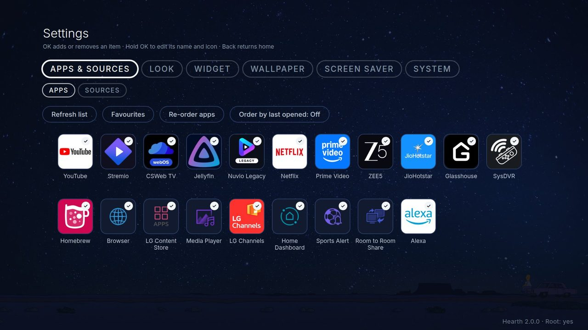

# Everything Hearth can do

All of Hearth's choices live in **Hearth Settings**. Find it as the last tile on the home row, or on the home row's menu if you hid it. The pages below explain each part in simple words.

| Page | What you learn |
|---|---|
| [Using Hearth](features/using.md) | The remote keys, the home row, favourites, names and icons, Recent apps, quiet mode |
| [Look](features/look.md) | Themes, icons, the row, app names, reset |
| [Widget](features/widget.md) | The clock, the date and the weather |
| [Wallpaper](features/wallpaper.md) | The background picture or slideshow |
| [Screen saver](features/screensaver.md) | Pictures and videos when the TV rests |
| [System](features/system.md) | Language, Home button, remote buttons, start with the TV, memory, Debug tab |
| [Without root](features/no-root.md) | What works when the TV is not rooted |
| [Custom themes](theme/theme-guide.md) | Make a whole new look in a zip file |
| [Language files](language_packs.md) | Add your own language |

**How Settings work.** The tabs are at the top: *Apps & Sources, Look, Widget, Wallpaper, Screen saver, System*. Press **Left** and **Right** on the tab bar to change tab. Some rows sit in **groups** (a folder of rows). Press **OK** to open a group. Press **Back** to close it. Rows that do not work on your TV are **grey**, and they tell you why. Press **OK** on a row to step through its choices, or **Left/Right** to change a number.

