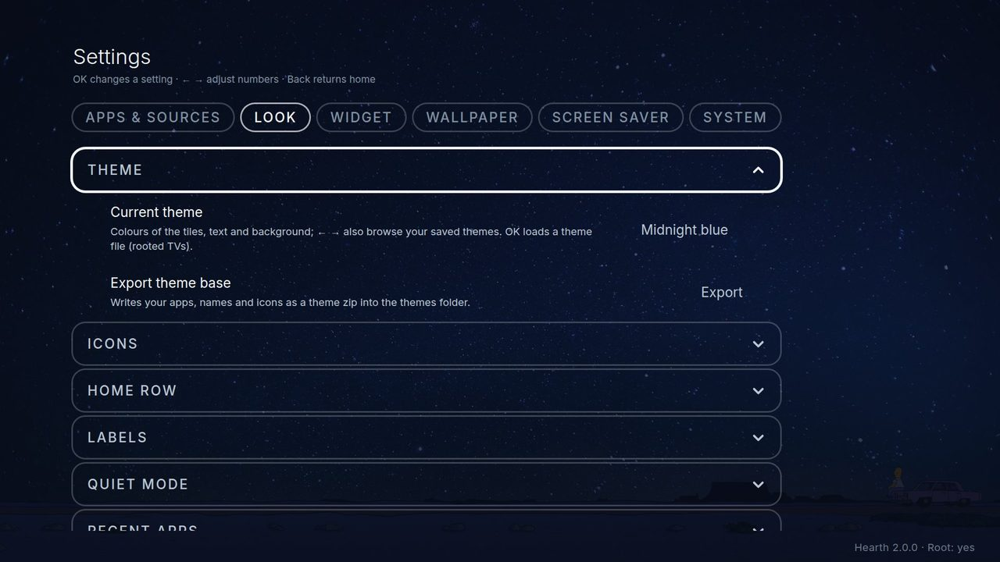
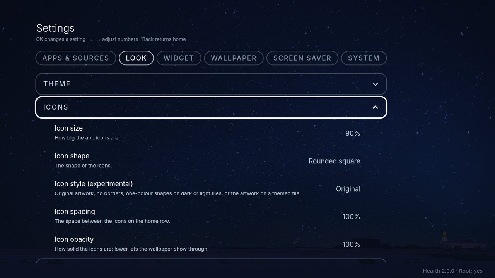
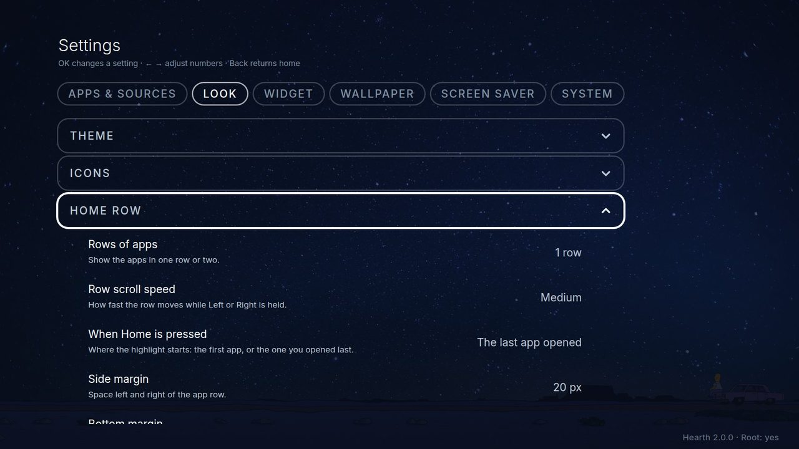
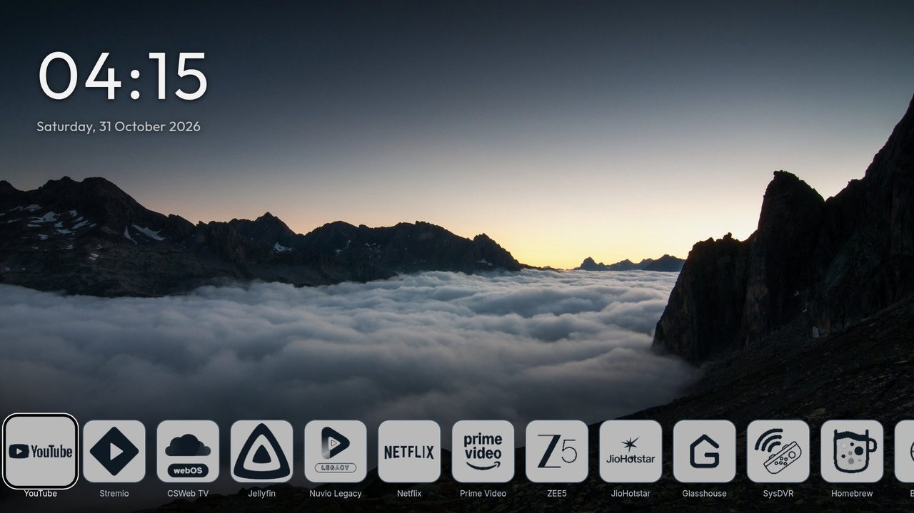
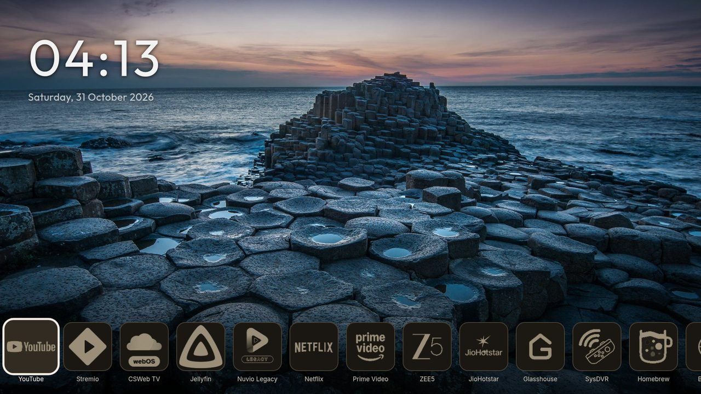
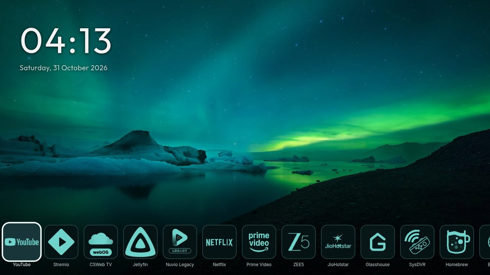

# Look

Everything in **Settings, Look**. Changes show at once on the home screen.

## Theme

A theme sets the colours of the tiles, the text and the background. Six are built in: **OLED black** (pure black, the starting choice), **Calm blue-grey**, **Midnight blue**, **Deep forest**, **Deep teal** and **Warm graphite**. Press Left or Right on **Current theme** to try them.

On a rooted TV you can also load your own theme:

- **OK** on *Current theme* loads a theme zip from the themes folder on the TV.
- **Export theme base** writes a starter zip with your apps (in their order), names and icons. **Start here:** this is the only way to get your app list and icons into a theme, so export first, then change the zip. Copy it to a computer, change it (or ask an AI helper to), and put it back in the themes folder.
- **Save this theme** keeps a loaded theme inside Hearth. **Delete this theme** removes it again.

How to make a theme: [Custom themes](../theme/theme-guide.md).

## Icons

- **Icon size, icon spacing, icon shape.**
- **Icon style:** *Original* (the real picture), *Minimal*, *Dark mono*, *Soft mono*, *Accent mono*, *Gradient mono* (one-colour shapes) and *Tinted tile* (the real picture on a coloured tile). These are experimental.
- **Icon tile:** a *Dark* tile with a light shape, or a *Light* tile with a dark shape.
- **Icon colour:** the colour of the shapes (follows the theme at first).
- **Icon opacity:** lower numbers let the wallpaper show through.

## Home row

**Rows of apps** (one or two), **Row scroll speed** (how fast a held arrow runs), **When Home is pressed**, **Side margin** and **Bottom margin**, **Show input status**, and the switches for the **LG Home** and **System Settings** tiles.

## Labels (the app names)

Switch the names under the icons on or off, and choose their colour, font, size and thickness.

## Quiet mode, Favourites, Recent apps

Quiet mode and OLED shift are explained in [Using Hearth](using.md#quiet-mode-and-oled-care). *Favourites* has its own side and bottom margin. *Recent apps* has the panel size (Small, Medium, Large).

## Reset

**Reset Hearth visual settings to default** puts the theme, wallpaper, look, quiet mode, clock and weather back to the starting values. Your apps, their order and favourites are not touched. After updating from 1.x, **Restore my settings from before the update** brings back your old look once.

