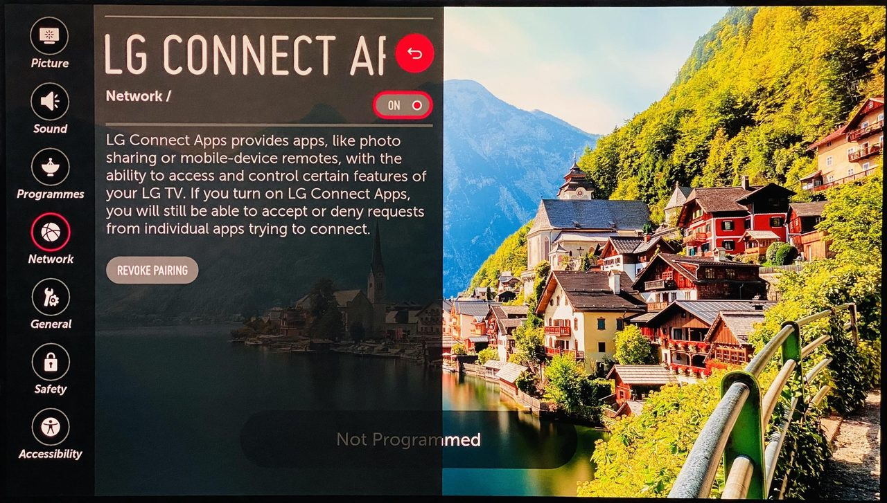

# Without root

Not rooted? Hearth still works. You open it yourself from the TV's app list.

## What works

- The home screen, the clock, the date and the **weather**.
- Themes, icons, sizes, fonts and colours.
- The 25 bundled photos and slideshows, quiet mode, OLED shift.
- Favourites, order, hiding apps, your own names and the built-in icons.
- Languages that come with Hearth.
- Opening apps.
- **Check for updates** (Settings, System, first row). It shows if a newer Hearth exists; OK then opens the Homebrew Channel, where you update Hearth by hand.

## What needs root (grey, with the reason)

The Recent apps panel, reading USB sticks and storage (own wallpapers, own icons), uninstalling apps, theme and language files, the Home button and **Replace LG Home**, the power-on app, the screen saver, remote buttons, LG preloaded apps and Keep Hearth ready.

## Get the full app list without root

By default Hearth shows a list of well-known apps. To see **all** your apps with their real icons:

1. On the TV turn **LG Connect Apps** on. It is in the LG menu under **Network, LG Connect Apps** (newer TVs: **All Settings, Connection, Mobile Connection Management**).
   
2. In Hearth open **Settings, System** and press OK on the app-list row.
3. The TV asks if it may allow the connection. Press **OK** on the TV.

Newer LG TVs refuse a web page's own connection. So a tiny helper that comes with Hearth makes the connection instead. This was **tested on a TV that is not rooted** (webOS 11.2.0, firmware 43.21.44). It may not work on every TV; if it fails, the built-in list stays. The key that pairs Hearth with the TV stays inside Hearth.

## Opening Hearth quickly without root

**LG Home cannot be replaced without root.** The TV closes a normal app when another app opens, and an app cannot see which app is in front. Two ways to get close:

- **Quick Access (any TV).** Open Hearth once. Then **hold a number key 1 to 9** on the remote (or open the TV's *Quick Access* setting) and choose Hearth. From now on, pressing that number key opens Hearth from anywhere. It starts fresh each time, so it is slower than with root.
- **A second device that stays on (advanced).** A small program on a Raspberry Pi or a home server watches the TV and tells it to open Hearth when LG Home shows. See [webos-vibehack](https://github.com/OmkarK97/webos-vibehack) by OmkarK97. Not tested with Hearth.

In Hearth, **Settings, System, Open Hearth without root: guide** shows a short version of this.
