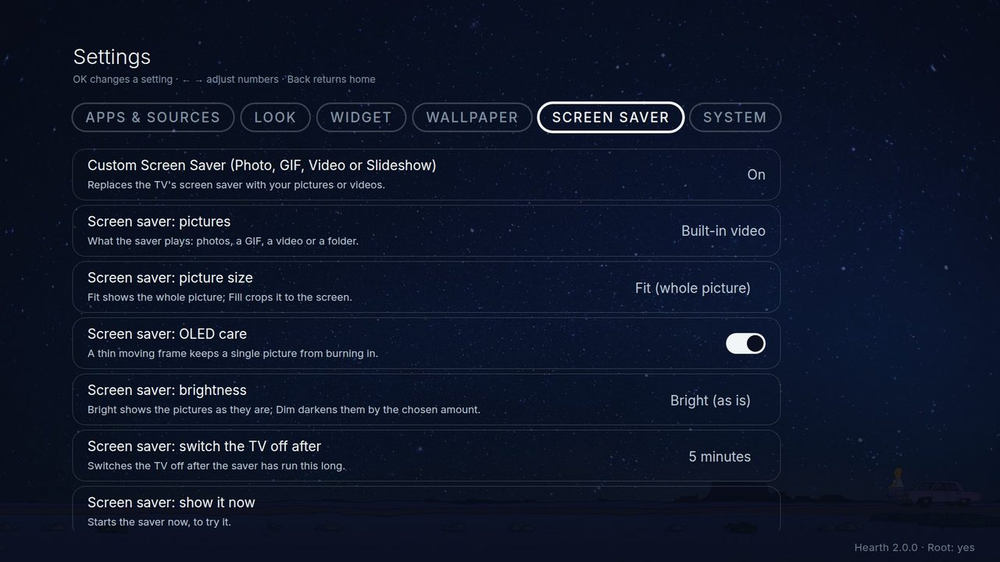

# Screen saver (rooted TVs, experimental)

A screen saver shows pictures when nobody has pressed a button for a while. Hearth's saver replaces the TV's own saver with **your pictures, GIFs, videos or a slideshow**. It is **on at first** and plays a short built-in **fireplace video**. If its set-up fails, Hearth turns it off and tells you.

Open **Settings, Screen saver**:

- **Custom Screen Saver:** the main switch.
- **Pictures:** what it plays: a photo, a GIF, a video (mp4, mkv or webm, plays quietly to its end), a folder, the bundled photos, or the same as the wallpaper.
- **Change picture every** and **Shuffle**, for slideshows.
- **Picture size:** *Fit* shows the whole picture; *Fill* crops it to the screen.
- **OLED care:** a thin moving frame so one still picture cannot burn into the screen.
- **Brightness:** *Bright*, or *Dim* by an amount you choose, from 10% to 80% in steps of 10 (a dark layer; the backlight is not touched).
- **Switch the TV off after:** the TV goes to sleep after the saver has run this long (5 minutes at first).
- **Show it now:** starts it at once, so you can try it.

**The TV decides when the saver starts.** It uses the idle time from the TV's own screen saver settings, so that setting must be on. Any key stops the saver.

Good to know:

- Nothing is written on the TV's storage. A restart puts LG's saver back, and Hearth puts its own on again.
- GIFs, videos and fast slideshows use more power than one still picture. A very big GIF or video may use a lot of memory.
- Put your own saver pictures in `/media/developer/screensavers` (see [Wallpaper](wallpaper.md#your-own-pictures-rooted-tv)).
- **On webOS 10 and newer this is untested.** The TV's own saver is built differently there and some TVs refuse the change. Some TVs also hold the saver back (OLED, or inputs with no signal).
- If it does not work, switch on the Debug tab (see [System](system.md#debug-tab)) and send us the report.
