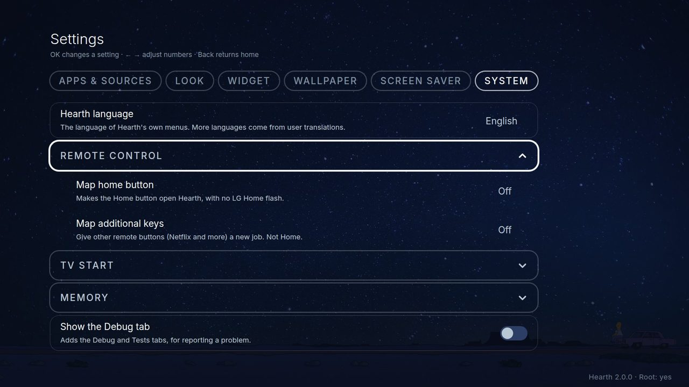
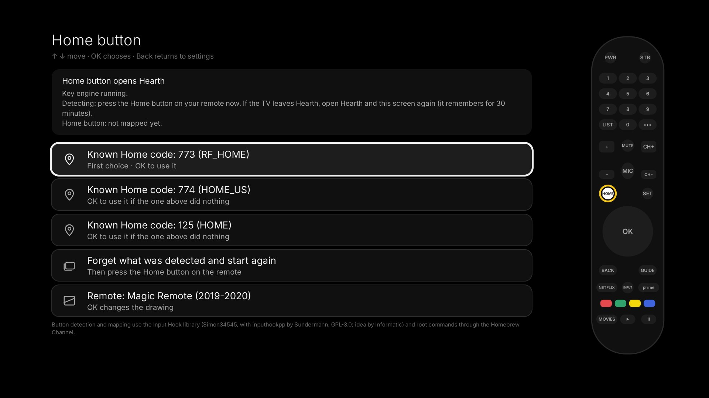
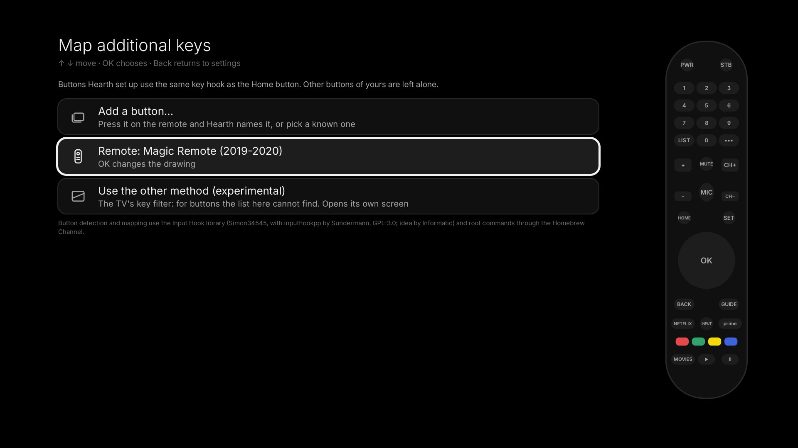

# System

**Settings, System** holds the things that talk to the TV itself. Most of them need a **rooted** TV. On a TV that is not rooted they are grey and say why, and only the language row, the app-list row, the no-root guide and the Debug switch stay. See [Without root](no-root.md).

## Hearth language

The first row. Press Left or Right to switch between **English**, the languages that come with Hearth (**Indonesian, Spanish, German, Arabic**; no root needed) and **your own language file** (press OK to load it, rooted TVs). The bundled languages were made by a computer helper and say *(machine translated)* until a person who speaks the language checks them. Anything a language lacks stays in English. Everything changes at once. **Remove the language file** deletes your own file again. How to make or share a language: [Language files](../language_packs.md).

## Remote control

### Map home button

This makes the **Home** button on your remote open Hearth, with no flash of LG's home screen. Hearth carries a small key helper (from the open-source project *Input Hook*), so you need no other app.

1. Open **Settings, System, Remote control, Map home button**.
2. Press the **Home** button on your remote when Hearth asks.
3. If Hearth knows the button's number (773, 774 or 125 are the usual ones), it **maps it by itself** and a message tells you whether it worked. If it does not know it, a guide shows the pressed button on a drawing of your remote, and you can pick the number by hand.
4. The mapping stays after restarts.

If the separate *Input Hook* app is installed with its own settings, Hearth does not touch them. It greys out its rows and says why.

### Map additional keys (experimental)

Give the other buttons on your remote, such as the **colour keys** and other dedicated buttons, a new job: open any app or input, open Hearth, mute, or do nothing. Press **Press a button to reassign it** and press the button you mean. The keys **Home, arrows, OK, Back, power, volume, channels and numbers** are never taken. After your first change Hearth asks whether the remote still works. Only when you say yes does it keep the change after a restart. The change is added in the TV's memory only, so a restart without keeping it undoes it.

## TV start

- **When the TV turns on, open...:** choose Hearth (or any app) to open when you switch the TV on, instead of Live TV. It starts working after **one full restart** of the TV. Choose *TV default* to undo it. It can also react to a network wake-up where the TV supports it.
- **Replace LG Home (helper):** one click installs a small helper that watches the TV. When LG Home would show, Hearth opens instead. LG Home can **flash for a moment** first; the Home button mapping above avoids the flash for the Home key. Turn this off before you uninstall Hearth (if you forget, the next TV start cleans up).
- **Show the LG logo when the TV starts:** LG's own switch, normally hidden in a secret menu. Turn it off for a cleaner start.
- **Set Hearth as the TV's Home app (experimental):** writes Hearth into the TV's own Home setting. It worked on webOS 4.5 and does **not** work on webOS 7.6. It cannot be used together with *Replace LG Home*.
- **Remove Hearth from the TV's inputs:** shows only if an old Hearth added itself as an input; press OK to take it out.
- **App list from the TV without root** and **Open Hearth without root: guide:** only on TVs that are not rooted. See [Without root](no-root.md).

## Memory (rooted, experimental)

- **LG preloaded apps:** LG keeps apps like YouTube, the browser and other video apps half-awake in the background, so they open fast. On some TVs that uses hundreds of megabytes. This list shows them and how much memory each uses. Press OK to switch one off (it then opens a little slower) or back to LG's setting. Nothing that is running is closed. *Everything back to LG's setting* undoes it all.
- **Keep Hearth ready:** asks the TV to keep Hearth in memory, so Home opens it at once. It uses TV memory, so you see a **warning** first. If a step fails, the switch goes back to Off and says why.
- **Reopen Hearth if the TV closed it:** works only together with *Keep Hearth ready* (it is grey while that is off). Both are grey on a TV that has no memory list.

## Debug tab

**Show the Debug tab** adds two tabs, *Debug* and *Tests*, for finding problems. Switch it on when you report a problem. It shows what Hearth sees (versions, the TV's answers, a list of events). A rooted TV also keeps the report in `/tmp/hearth-debug.txt`. Send it with your issue on [GitHub](https://github.com/rudra-avatar/Hearth/issues), or take a photo of the screen.
