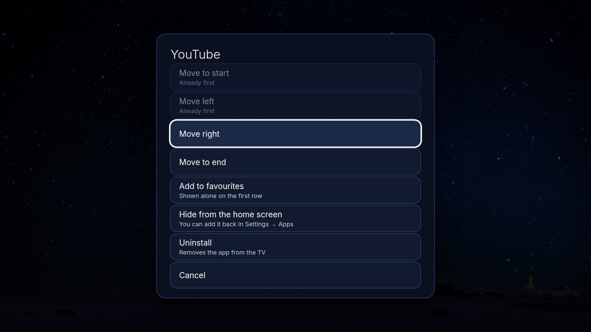
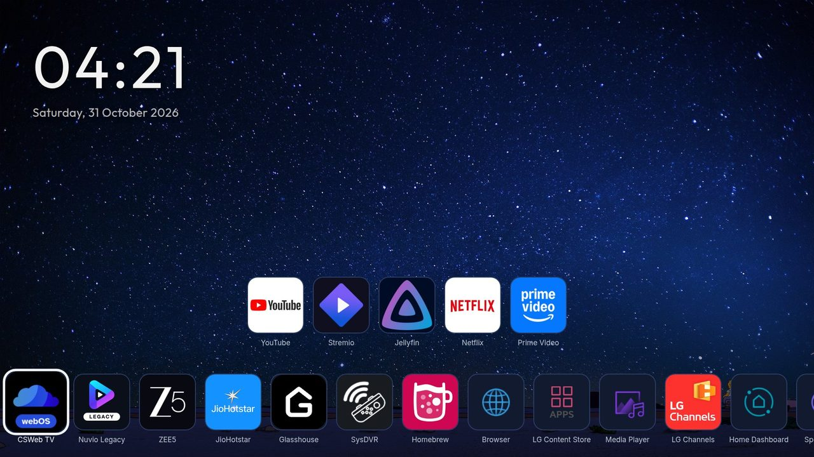
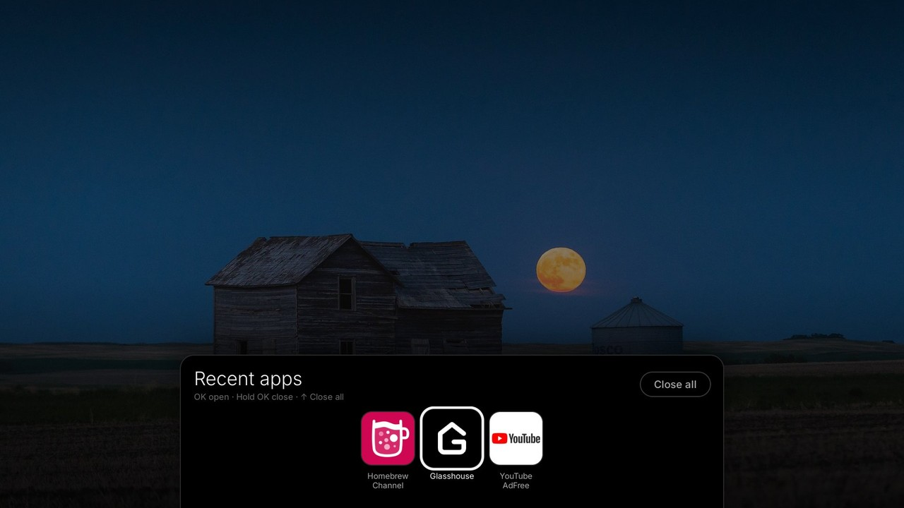
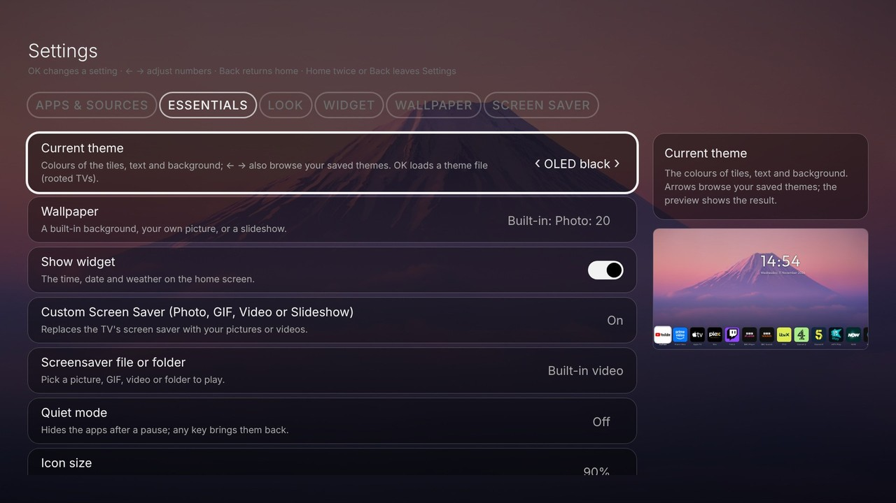
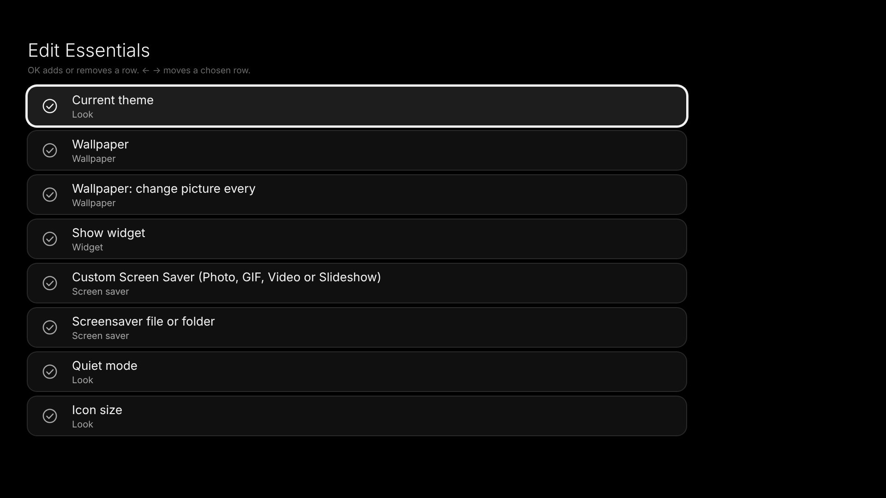
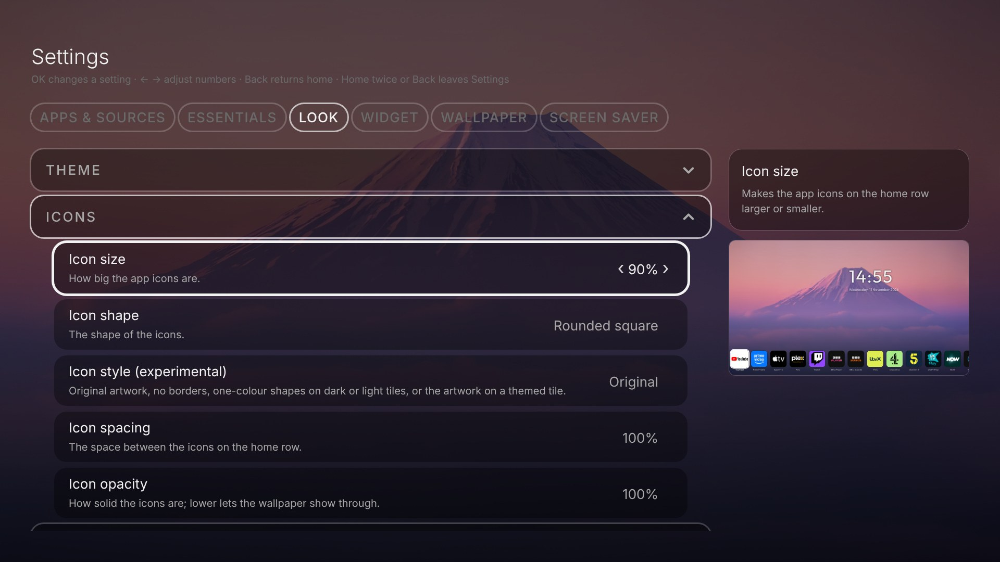
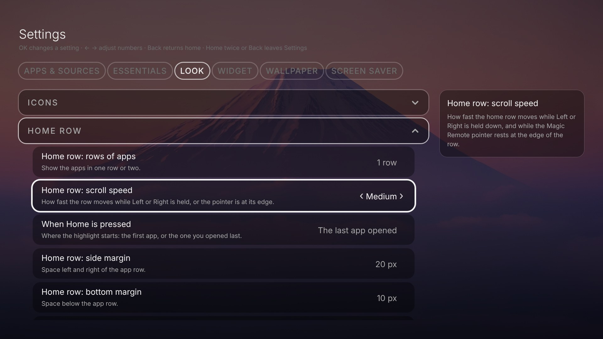
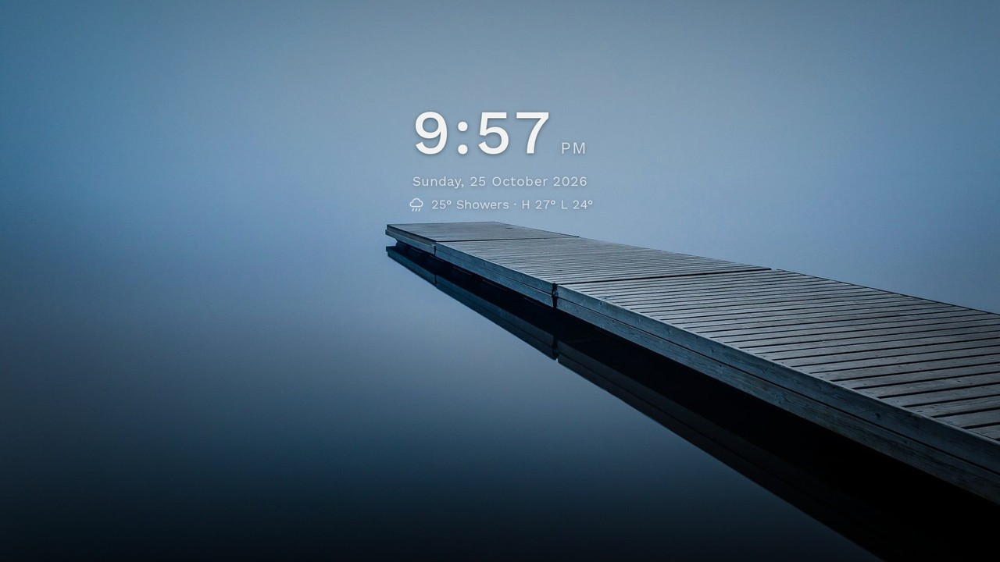

# Using Hearth

## The remote keys

| Where | Key | What happens |
|---|---|---|
| Home row | Left / Right | Move along the row. At the end it goes round to the start |
| Home row | OK | Open the app |
| Home row | hold OK | The app's menu: reorder the row, add to favourites, hide it, uninstall it |
| Home | Back | The **Recent apps** panel (OK opens an app, hold OK closes it, Up is *Close all*) |
| Settings | Left / Right on the tab bar | Change tab |
| Settings | OK, or Left / Right | OK steps through choices; the arrows change numbers |
| Any other screen | Back | One step back |

The last tile of the row is **Hearth Settings**. Two more tiles, *LG Home* (opens LG's own home screen) and *System Settings* (the TV's own settings), are hidden at first. Switch them on in **Settings, Look, Home row**.

## Choose which apps show, and in what order

Open **Settings, Apps & Sources**. You see every app and every input (HDMI 1, HDMI 2 ...). Press **OK** on one to show or hide it. The buttons above the grid:

- **Refresh list:** looks for apps you installed a minute ago.
- **Favourites:** see below.
- **Uninstall apps:** (Apps tab, rooted TV only.) Press it, then press **OK** on an app and confirm. The app is removed from the TV for good. Apps that belong to the TV, and Hearth itself, cannot be removed; Hearth tells you why. Press **Done** (or Back) when you finish.
- **Most used:** a switch. The apps you open most often come first (favourites keep their places). While it is on, reordering by hand is not offered. Switch it off and your own order is back.

## Put the apps in your own order

On the Home screen hold **OK** on an app and choose **Reorder home row**. That app is picked up. Press **Left** or **Right** to move it, **OK** to put it down (press OK on another app to pick that one up), **Back** once to put the app down and **Back** again to leave. Favourites and the other apps each keep their own order. The order is saved a moment after your last move. If a pause hides the apps (Quiet mode) the mode ends and your order is kept. The entry is not offered while *Order by last opened* is on.

## Favourites: a short shelf

Hold **OK** on an app and choose **Add to favourites**. When you have favourites, the home screen shows **only that row**. Press **Down** to see the row with all the other apps. Press **Up** to hide it again. Remove a favourite the same way. Margins for this row are in **Settings, Look, Favourites**.

## Your own names and icons

In **Settings, Apps & Sources** hold **OK** on an app or an input, let go, then press **Down** to edit.

- **Name:** up to 24 letters. Inputs offer ideas (PlayStation 5, Xbox, Laptop ...). Press OK to type any name.
- **Icon:** pick one that comes with Hearth, or **use your own picture** from a USB stick or the TV's storage (rooted TVs). A square picture is best. Hearth shrinks it and keeps it inside its own settings, so you can pull the USB stick out afterwards.
- **Use the app's name and icon** puts the original back.

The names in the *Hide* and *Uninstall* menus stay the real names.

## Recent apps

Press **Back** on the home row to see the apps you used lately. **OK** opens one. **Hold OK** closes it. **Up** and OK on *Close all* closes them all. This needs a rooted TV. The panel size is in **Settings, Look, Recent apps**.

## When you press Home

**Settings, Look, Home row, When Home is pressed** decides where the highlight starts: on the **first app** (the starting choice on a new install), or on the app you **opened last**. Right after you switch the TV on, the highlight always starts on the first app until you open something.

## Essentials, help and previews

The **Essentials** tab, right after Apps & Sources, holds the settings most people change: theme, wallpaper, widget, screen saver, quiet mode and icon size. The rows are the same ones as in the other tabs, so a change made in either place is the same change.

Make the tab your own with its last row, **Edit Essentials**. **OK** adds a row (a circle) or removes it (a tick). **Left** and **Right** move a chosen row up or down. **Reset to default** brings the starting set back.

Beside the list, a short **help text** says what the focused row does. For rows that change how Home looks, such as icon size, margins, row speed, the wallpaper and the widget position, a small **preview** of the home screen sits under the help text, so you see the result at once.

## Quiet mode and OLED care

- **Quiet mode** hides the apps after a pause, so only the clock stays. Any key brings them back. With a Magic Remote, a moving or pressed pointer only wakes the apps: it highlights and clicks nothing until the pointer has rested for a moment. Choose the pause (Off, or 10 to 60 seconds) in **Settings, Look, Quiet mode**. At first it is 20 seconds.
- **Dim the screen after** makes the whole picture darker some seconds later. **Dim strength** says how much (10 to 80 percent). This is a dark layer, the TV's backlight is not touched.
- **OLED shift** moves the clock and the apps a tiny bit every minute, so a still picture does not burn into an OLED screen. It is on at first.

## Input status

Inputs with nothing plugged in are greyed out. On a rooted TV, the name of a connected device (for example your game console) shows under its input. Switch this in **Settings, Look, Home row, Show input status**.
