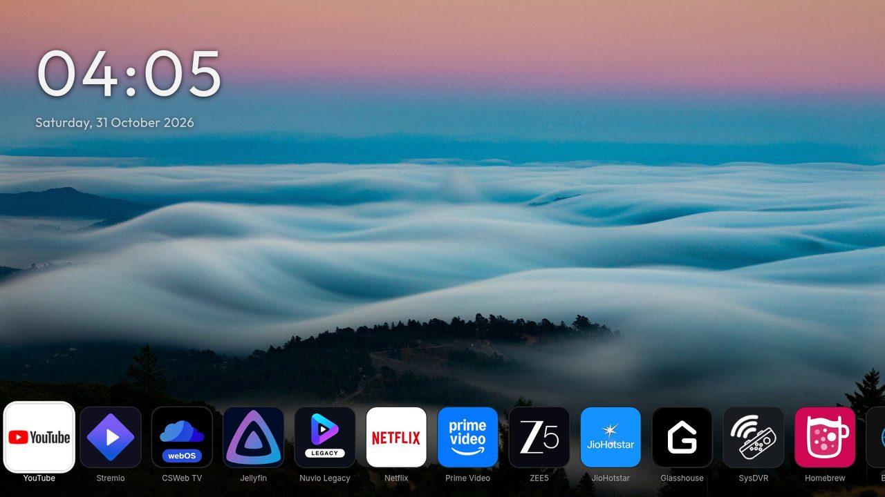
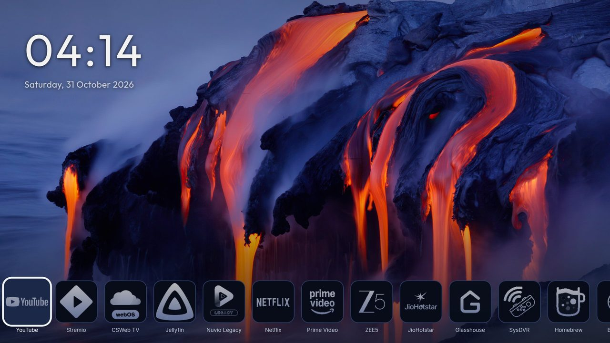

# Wallpaper

The wallpaper is the picture behind everything. Open **Settings, Wallpaper**.

- **Wallpaper:** OK opens a picker. Choose plain black (or the theme's colour), one of the **25 photos** that come with Hearth, a **slideshow** of those photos, or your **own picture** or **folder**.
- **Change picture every:** from 10 seconds to 1 hour.
- **Shuffle:** random order, or A to Z.
- **Wallpaper opacity:** lower numbers make the picture softer.
- **Bottom fade:** darkens the bottom of the picture so the icons stay easy to read.

## Your own pictures (rooted TV)

The picker shows a folder browser: a **USB stick**, or **Internal storage** (`/media/developer`). Press OK on a picture to use it. Press OK on **Play this folder as a slideshow** to show every picture in it. When the folder has other folders inside, a second row plays those too. There is no limit on how many pictures.

Hearth makes two folders for you: `/media/developer/wallpapers` for wallpapers and `/media/developer/screensavers` for the screen saver. The picker shows them first. To copy pictures there:

1. From a computer with SSH: `scp photo.jpg root@<TV address>:/media/developer/wallpapers/` (if that fails, try `scp -O photo.jpg ...`).
2. Or open the TV in [webOS Dev Manager](https://github.com/webosbrew/dev-manager-desktop) and use its file manager.
3. Or put the pictures on a USB stick and plug it into the TV.

`<TV address>` is the **IP** number at the bottom right of Hearth's Settings.

## Picture size matters

A big picture makes the TV work harder. **The best size is 1920x1080**: it looks good and Hearth stays fast. Please make your pictures that size. The hard limit is **8 MB and 25 megapixels** per picture; a bigger picture is skipped in a slideshow and refused as a single wallpaper. Use JPG, PNG, WebP or BMP. A photo that appears turned the wrong way should be rotated on the computer first.

