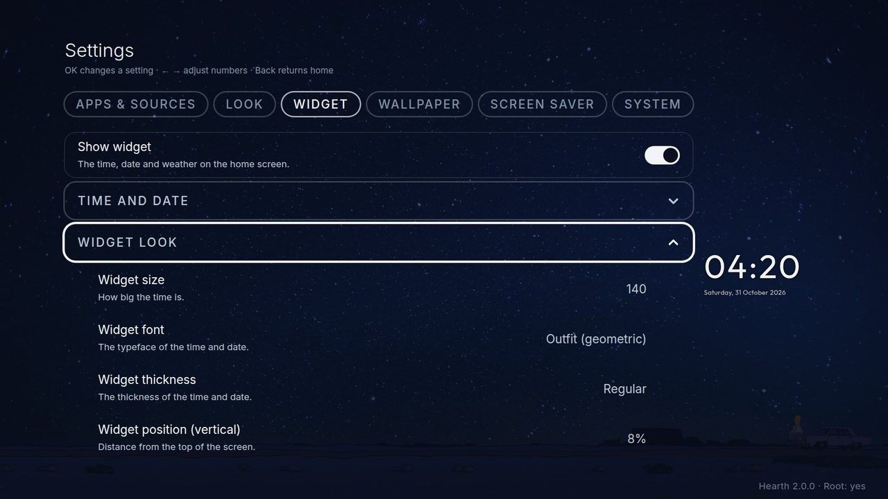
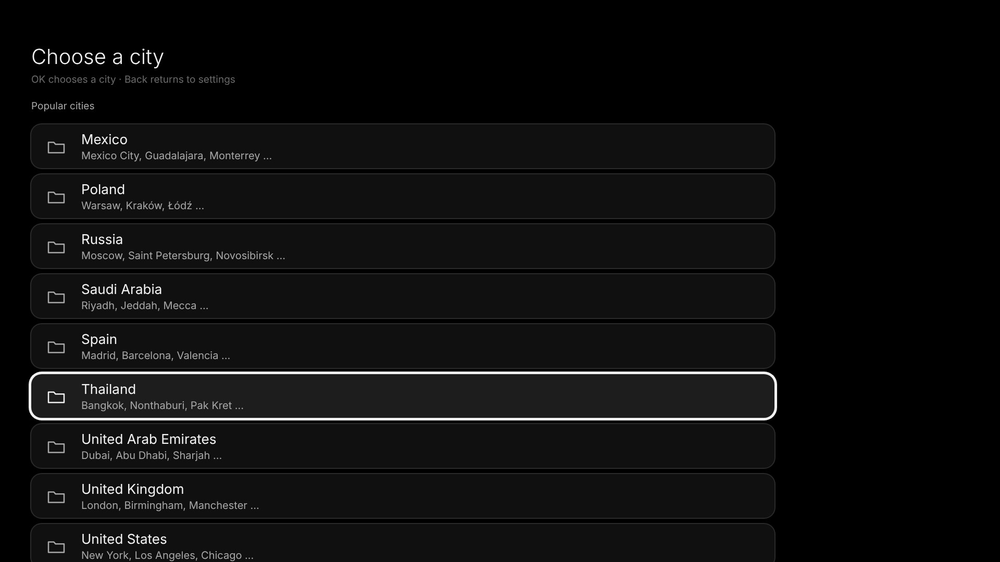
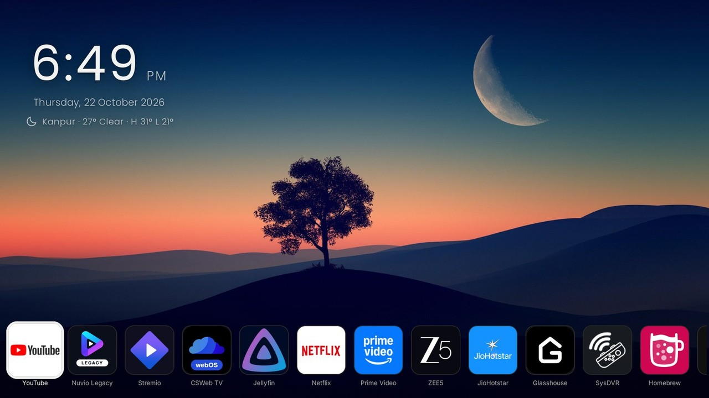

# Widget: the clock, the date and the weather

The widget is the group of time, date and weather at the top of the home screen. Find it in **Settings, Widgets**. A small live picture of it sits beside the list, so you see each change right away. The same tab also holds the **PlxNative** rows (see below).

- **Show the clock widget:** switches the clock, date and weather off if you want a clean screen (the PlxNative rows stay as they are).
- **Time and date:** 12-hour, 24-hour or the same as the TV; show the date; show AM or PM.
- **Widget look:** size, font (27 typefaces), thickness, position (up-down and left-right, 50 is the middle), alignment (left, centre or right), colour, shadow, backdrop and opacity. A light picture makes white text hard to read: choose a dark colour, a shadow or a backdrop. The *backdrop* is a soft dark or light glow behind the widget that fades out towards its edges; Off, or 5 to 100 percent in steps of 5 (more percent = stronger); it is dark behind light text and light behind dark text. It is Off until you turn it on. *Follow theme* picks a nice colour for each theme.
- **Weather:** off at first. Switch it on, choose **City** and the **temperature unit** (Celsius or Fahrenheit), and choose whether the city name and today's high and low show. Pick a city from the list (grouped by country, up to 50 each), or choose **Search for a city** and type any place.

## PlxNative rows: Continue watching and Recently added

Two rows of posters from your Plex server can sit below the home row. Choosing one opens it in [PlxNative](https://github.com/GLinnik21/plx-native), the native Plex app for webOS (it must be installed; the official Plex app is not used). Find them in **Settings, Widgets, PlxNative**. Both are off at first.

- **Continue watching row** and **Recently added row:** each one on or off.
- **Account:** OK shows a short code; enter it at `plex.tv/link` on a phone or computer. While you are signed in the row shows your account, and OK offers **Choose a server** and **Sign out**.
- **Server:** the server the rows come from, your own or one shared with you.
- **When an item is chosen:** *Play* starts it in PlxNative where you left off; *Open details* shows its page there. A season always opens its page.

On the home screen, press **Down** from the home row: the screen slides up and the rows appear. With favourites set, Down goes from the favourites row to the PlxNative rows and then to the row of all your other apps. **Up** goes back, **Back** returns to the home row.

The rows are drawn from a saved copy and refreshed in the background: a few seconds after Hearth starts, when you come back from another app, and every 10 minutes. The posters always come straight from your server, so they are missing while it is off. The sign-in stays on this TV and is never part of a theme export or the debug log.

## About the weather and privacy

The weather comes from [Open-Meteo](https://open-meteo.com), a free service with no account. Hearth sends only the place's map position (and the words you type in the city search). It asks a few seconds after Hearth appears and then every 30 minutes while Hearth is in front. The last answer is kept, so the home screen never waits for the internet. An answer older than 6 hours is not shown. It needs the TV to be online.

Some networks block the address of Open-Meteo's main forecast server (`api.open-meteo.com`) while the rest of Open-Meteo stays reachable. When the main server does not answer, Hearth asks two other Open-Meteo servers that give the same forecast (`historical-forecast-api.open-meteo.com`, then `previous-runs-api.open-meteo.com`) and remembers the one that answered, so the next refresh asks it first. Only Open-Meteo is ever asked, and it is sent the same map position.
