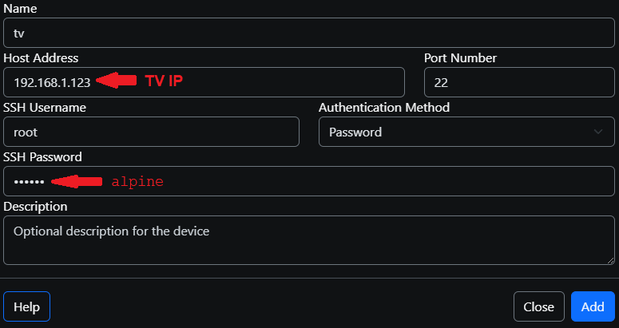

# Step 3: Install Hearth

Pick **one** way. If your TV is rooted, use way A: it is the easiest and later gives you an **Update** button. If it is not rooted, use way B. Way B also works on a rooted TV if you prefer a file.

## A) Through the Homebrew Channel (rooted TV)

1. Open the **Homebrew Channel** on the TV and go to **Settings**.
2. Choose **Add repository** and type this address exactly:

   `https://raw.githubusercontent.com/rudra-avatar/Hearth/main/repo/apps.json`

   Typing with the remote is slow. Use your phone as a keyboard (see "LG Power" below).
3. Go back to the app list, open **Hearth** and choose **Install**.
4. Open **Hearth** from the TV's app list. That is all.

## B) With webOS Dev Manager (computer or Android phone)

webOS Dev Manager is a free helper from the webOS Brew community. It talks to the TV over your home network, so you can put an `.ipk` file on the TV without typing commands. It also has a file manager and a terminal.

**Get it**

- **Android phone or tablet:** the app **webOS Dev Manager** by *webOSbrew* on Google Play: <https://play.google.com/store/apps/details?id=org.webosbrew.devman>
- **Windows, Mac, Linux:** <https://github.com/webosbrew/dev-manager-desktop> (the **Releases** page).
- iPhone and iPad: we know of no version.

**Get the file**

Download the newest `tld.my.customlauncher_<version>_all.ipk` from the **Releases** page of <https://github.com/rudra-avatar/Hearth>. On a phone it lands in *Downloads*. Phone (or computer) and TV must be on the same Wi-Fi or network.

**Connect the TV: TV with only Developer Mode (not rooted)**

1. On the TV open the **Developer Mode** app (see [Step 1](developer-mode.md)). **Dev Mode Status** must be **ON** and **Key Server** must be **On**. Leave this screen open. It shows the TV's **IP address** and a **passphrase**.
2. In Dev Manager choose **Add device** (on the computer: **+ Add Device**). Type the TV's **IP address** (host address) and the **passphrase** from the Developer Mode app. Keep the other settings as they are and confirm.
3. The TV now shows in the list of devices. Screens differ a little between the computer and the phone version and between versions, but the app asks for the same two things.

**Connect the TV: rooted TV**

1. Open the **Homebrew Channel**, go to **Settings** and switch **Enable SSH server** on. Restart the TV if the Homebrew Channel asks for it. The Homebrew Channel's own page also shows that **Root status** is **ok**.
2. Find the TV's **IP address**: *Settings, Network* on the TV, or the router's device list.
3. In Dev Manager choose **Add device** and type the IP address. A rooted TV is reached over **SSH**: user `root`, port `22`, and the password `alpine` unless you set your own password or installed an SSH key. If the app lets you pick how to log in, pick the SSH / rooted-TV option. (A rooted TV often no longer has the Developer Mode app, so there is no passphrase to type.)

   

   In the picture, the red arrows show the two values you type: the **TV's IP address** and the password (`alpine`, unless you changed it). Give the TV any name you like, press **Add**, and it appears in the device list.
4. If the TV does not connect, check that phone and TV are on the same network, that the SSH server is on, and see [Troubleshooting](../troubleshooting.md).

**Install the .ipk file**

1. Pick your TV in Dev Manager and open its **Apps** page.
2. Press **Install** (on the computer it is at the top right) and choose the downloaded `.ipk` file. On the phone the file picker opens in *Downloads*.
3. Wait until Dev Manager says it is installed. It takes under a minute.
4. Open **Hearth** from the TV's app list.

To update, install the newer `.ipk` file the same way. Your apps, their order, names and favourites are kept. To remove Hearth on a rooted TV, use **Settings, System, Uninstall Hearth and undo all system changes** inside Hearth: it takes back what Hearth changed on the TV and uninstalls it. On a TV with only Developer Mode, use **Uninstall** on the same Apps page of Dev Manager.

## C) Over SSH (rooted, for people who like typing commands)

Copy the file to the TV, then run the install command. The exact commands are in the [README](https://github.com/rudra-avatar/Hearth#option-2-install-the-file-yourself).

## Use your phone as the TV remote: LG Power (Android)

Typing letters with the TV remote takes ages. **LG Power** is a free Android remote for LG TVs with a keyboard that types straight into the TV. Phone and TV must be on the same Wi-Fi.

- Google Play: <https://play.google.com/store/apps/details?id=com.nic.lgpower>
- Source: <https://github.com/Nicsilver/LGPower> (a hobby project, not made by LG).

## SSH: typing to the TV from a computer

You need this only for way C and for fixing problems. Most people never need it.

1. In the Homebrew Channel Settings, switch the SSH server on.
2. On a computer open a terminal (the black window where you type). On Android or iPhone use any SSH app.
3. Type `ssh root@<TV address>` and press Enter. The first time it asks if it can trust the TV: say yes. The password is `alpine` unless you set your own or installed an SSH key.
4. TVs with only Developer Mode use another door (port 9922, user `prisoner`, a key with a passphrase from the Developer Mode app). Dev Manager hides this for you.

## Updating Hearth

With way A, open the Homebrew Channel, open Hearth and press **Update** when it shows a new version. On a rooted TV you can also do it inside Hearth: **Settings, System, Check for updates**, choose a version, press **OK**, then **Install** (a bar shows the progress). With way B, install the new file the same way. Your apps, their order, names and favourites are kept. **When you move from 1.x to 2.0.0, the look settings go back to the new defaults once**. Open **Settings, Look, Restore my settings from before the update** to bring your old ones back.

## Next

[Learn to use Hearth](../features/using.md).
